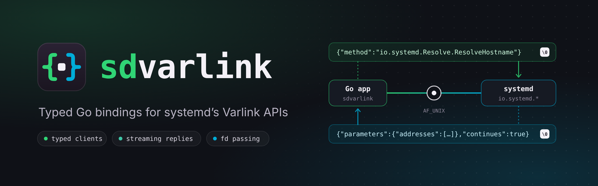
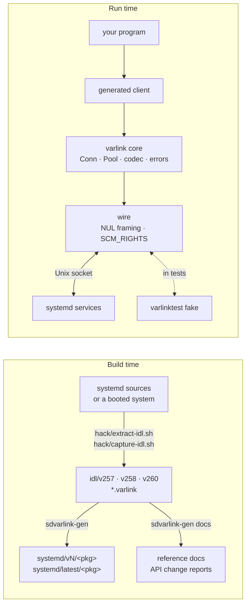

<p align="center">
  <a href="https://rossedman.github.io/sdvarlink/">
    
  </a>
</p>

<p align="center">
  <a href="https://github.com/rossedman/sdvarlink/actions/workflows/ci.yml"></a>
  <a href="https://github.com/rossedman/sdvarlink/actions/workflows/integration.yml"></a>
  <a href="https://pkg.go.dev/github.com/rossedman/sdvarlink"></a>
  <a href="https://goreportcard.com/report/github.com/rossedman/sdvarlink"></a>
  <a href="LICENSE"></a>
  <a href="https://rossedman.github.io/sdvarlink/"></a>
</p>

**sdvarlink** gives Go programs typed, generated, tested clients for systemd's
`io.systemd.*` [Varlink](https://varlink.org/) interfaces. It does for
Varlink what [coreos/go-systemd](https://github.com/coreos/go-systemd) does
for D-Bus, and it can serve Varlink too, so your Go daemons can publish
interfaces that systemd's tooling calls like any other.

```go
c, err := resolve.Dial(ctx) // /run/systemd/resolve/io.systemd.Resolve
if err != nil {
    return err
}
defer c.Close()

out, err := c.ResolveHostname(ctx, resolve.ResolveHostnameIn{Name: "github.com"})
for _, a := range out.Addresses {
    fmt.Println(a.Family, a.Address)
}
```

## Why

systemd is moving its APIs from D-Bus to Varlink: JSON messages, each ending
in a NUL byte, over a Unix socket. Varlink needs no broker, so it works in
early boot, in the initrd and in containers without `dbus-daemon`; it streams
replies and passes file descriptors. systemd v257 already shipped more
Varlink interfaces than D-Bus services, and new subsystems (userdb, metrics,
machine and image management) come Varlink-first or Varlink-only.

Until now, Go programs had to hand-roll JSON over sockets or shell out to
`varlinkctl`. sdvarlink is the missing piece:

|  | |
| --- | --- |
| **Typed clients, generated from systemd's own IDL** | Every `io.systemd.*` interface in systemd v257, v258 and v260 — 33 interfaces, structs, enums and errors — with doc comments from upstream. |
| **Streaming as Go iterators** | Methods that stream return `iter.Seq2[*T, error]`; `break` or cancel the context to stop. |
| **File-descriptor passing** | `*os.File` fields travel as `SCM_RIGHTS` in both directions, attached to the right message, with leak-proof ownership rules. |
| **Typed errors** | `errors.As(err, &resolve.NoNameServersError{})`, `errors.Is(err, resolve.ErrNoNameServers)`, and `io.systemd.System` errors that unwrap to `syscall.Errno`. |
| **Versioned per systemd release** | Import `systemd/v257/...` to support the oldest systemd you need, or `systemd/latest/...`; feature-detect newer methods with `Supports`. |
| **Serve interfaces too** | `varlink.Server` serves your own interfaces, or systemd's such as `io.systemd.Metrics`, with typed handlers, streams, peer credentials and socket activation. `varlinkctl` can't tell it from a C service. |
| **A fake for your tests** | `varlinktest` serves canned, scripted, streaming or recorded replies over a real socket — no systemd needed in CI. |
| **Small and pure Go** | No cgo; the runtime depends only on the standard library and `golang.org/x/sys`. |

## Install

```sh
go get github.com/rossedman/sdvarlink@latest
```

| Requirement | Supported |
| --- | --- |
| Go | 1.26+ (uses range-over-func iterators) |
| systemd | v257+ for the generated clients (older hosts get `varlink.ErrUnsupported`; fall back to D-Bus) |
| OS | Linux (amd64, arm64 tested). Core, parser and fake also build and test on macOS/BSD. |

## A tour

### Stream replies

```go
// All users known to systemd-userdbd, one reply per user.
for u, err := range c.GetUserRecordMore(ctx, userdatabase.GetUserRecordIn{
    Service: "io.systemd.Multiplexer",
}) {
    if err != nil {
        return err
    }
    fmt.Println(string(u.Record))
}
```

### Pass file descriptors

```go
img, _ := os.Open("app.raw")
defer img.Close() // you keep ownership of what you send

out, err := mountfsd.MountImage(ctx, mountfilesystem.MountImageIn{ImageFileDescriptor: img})
for _, p := range out.Partitions {
    defer p.MountFileDescriptor.Close() // you own what you receive
}
```

### Handle errors and older systems

```go
c, err := unit.Dial(ctx)
if errors.Is(err, varlink.ErrUnsupported) {
    return listUnitsOverDBus(ctx) // systemd too old, or not running
}
if ok, _ := c.Supports(ctx, "List"); !ok {
    return listUnitsOverDBus(ctx) // io.systemd.Unit.List arrived in v258
}
```

### Test without systemd

```go
func TestLookup(t *testing.T) {
    srv := varlinktest.NewServer(t)
    srv.Handle("io.systemd.Resolve.ResolveHostname",
        func(in resolve.ResolveHostnameIn) (resolve.ResolveHostnameOut, error) {
            return resolve.ResolveHostnameOut{Name: in.Name, Addresses: fakeAddrs}, nil
        })

    c, _ := resolve.DialPath(ctx, srv.Path())
    // ... exercise your code against the fake
}
```

### Serve your own interface

```go
srv := varlink.NewServer(varlink.ServerInfo{Vendor: "Example", Product: "queued", Version: "1.0"})
iface := srv.Interface("io.example.Queue", queueIDL) // the IDL clients will introspect

varlink.Handle(iface, "Depth", func(ctx context.Context, call *varlink.Call, _ struct{}) (DepthOut, error) {
    return DepthOut{Jobs: q.Len()}, nil
})

l, err := varlink.ListenActivated("") // a systemd .socket unit, or…
if errors.Is(err, varlink.ErrNotActivated) {
    l, err = varlink.Listen("/run/queued/io.example.Queue")
}
return srv.Serve(ctx, l) // drains in-flight calls when ctx ends
```

### Call anything, raw

```go
conn, _ := varlink.Dial(ctx, "/run/systemd/io.systemd.Manager")
var out json.RawMessage
err := conn.Call(ctx, "io.systemd.Manager.Describe", nil, &out)
```

More in [`examples/`](examples/): resolving names, listing users, units and
machines, a DNS query monitor, mounting images by fd, metrics, a mini
`varlinkctl`, feature detection, testing with fakes and recorded golden
files, and two servers: a job queue and an `io.systemd.Metrics` provider.

## How it fits together



Only the wire layer touches the socket, so the fake replaces systemd without
changing any code above it. The generator runs at build time; the module
you import is plain Go.

## Interoperability

The wire code is verified against systemd's own implementation in both
directions: the integration suite drives a real `sd-varlink` service
(systemd-journald) with sdvarlink's client, and drives sdvarlink's fake
server with systemd's `varlinkctl`. CI runs it against systemd v257, v258
and the newest release, booted as PID 1 in containers.

## Documentation

**[rossedman.github.io/sdvarlink](https://rossedman.github.io/sdvarlink/)** —
quickstart, guides for streaming, file descriptors, errors, versioning,
testing and migrating from D-Bus, the full interface reference, and the API
changes between systemd releases. API docs are on
[pkg.go.dev](https://pkg.go.dev/github.com/rossedman/sdvarlink).

## Status

Pre-1.0. The core API is settling; generated packages follow systemd's IDL
exactly. See the [roadmap](https://rossedman.github.io/sdvarlink/project/roadmap/).

## Contributing

Issues and pull requests are welcome — see [CONTRIBUTING.md](CONTRIBUTING.md).
Adding a new systemd release is one command (`make idl SYSTEMD_VERSION=N`),
and a weekly workflow does it automatically.

## License

[MIT](LICENSE). The IDL snapshots under `idl/`, and the doc comments the
generator copies from them into `systemd/`, come from systemd's interface
definitions; systemd is licensed LGPL-2.1-or-later.
