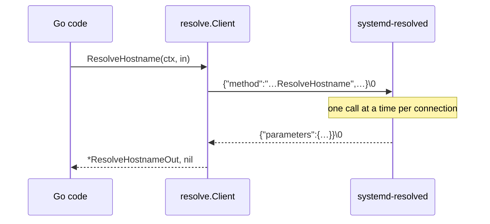
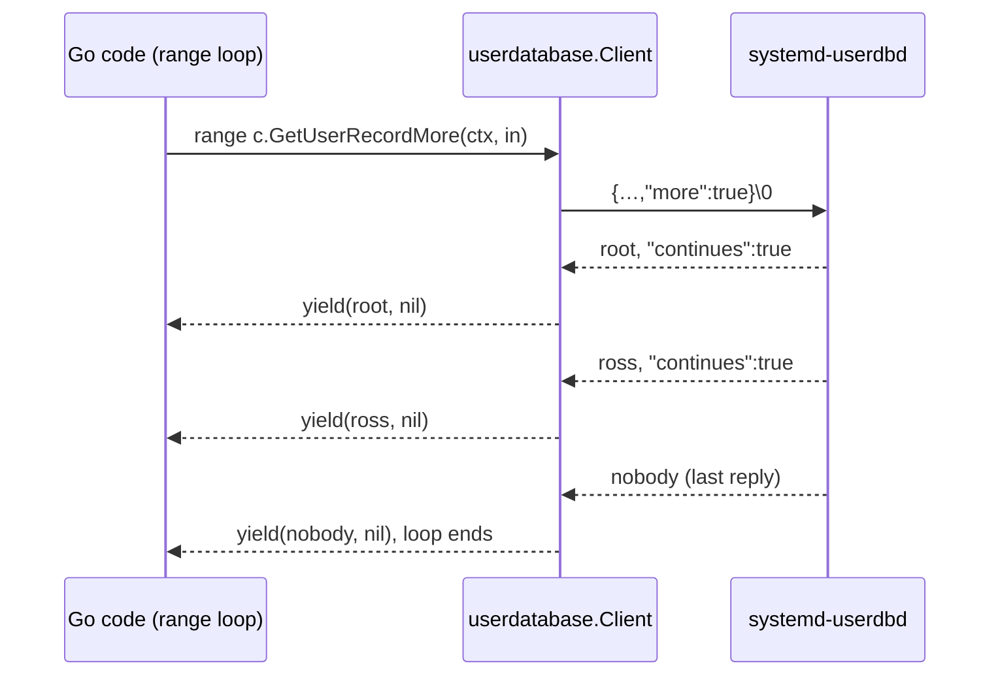
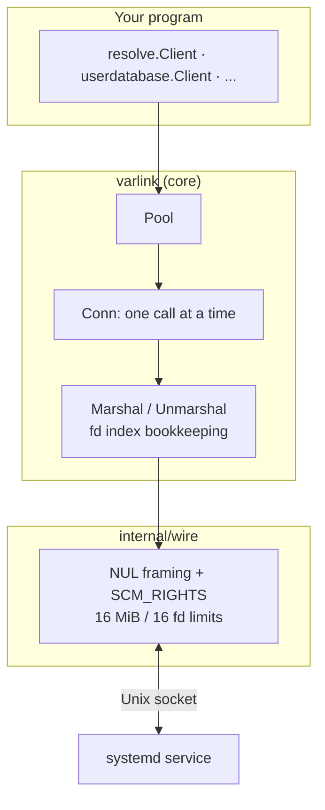

# Core concepts

Varlink is an IPC protocol: **JSON objects, each ending in a NUL byte, over a
Unix socket**. A service publishes its API in a small interface definition
language (IDL) and answers introspection calls. A call names a method and
passes parameters; the reply carries parameters or a qualified error name. A
client can ask for a stream of replies (`more`) or for no reply at all
(`oneway`).

That paragraph is the whole protocol. This page walks through each piece and
shows where it surfaces in sdvarlink.

## Sockets and services

Each systemd service listens on its own socket, at a fixed path. There is no
resolver and no bus: you connect to the file.

| Interface | Socket | Served by |
| --- | --- | --- |
| `io.systemd.Resolve` | `/run/systemd/resolve/io.systemd.Resolve` | systemd-resolved |
| `io.systemd.Hostname` | `/run/systemd/io.systemd.Hostname` | systemd-hostnamed |
| `io.systemd.UserDatabase` | `/run/systemd/userdb/io.systemd.Multiplexer` | systemd-userdbd |
| `io.systemd.Manager`, `io.systemd.Unit` | `/run/systemd/io.systemd.Manager` | PID 1 |

One socket can serve several interfaces: PID 1 answers both
`io.systemd.Manager` and `io.systemd.Unit` on the same path, and every service
also implements `org.varlink.service` for introspection. Generated packages
know their default socket (`resolve.DefaultSocket`); the full table is in
[Default sockets](../reference/sockets.md).

## Frames

A message is a JSON object followed by a single `\0` byte. Here is a real
exchange with `systemd-journald` v255, captured byte for byte while sdvarlink's
`journal.Client.Synchronize` ran:

```text
→ {"method":"io.systemd.Journal.Synchronize","parameters":{}}\0
← {"parameters":{}}\0
```

`→`
:   The call: a qualified method name (`<interface>.<method>`) and a parameters
    object. sdvarlink always sends `parameters`, even when empty.

`←`
:   The reply: an object with `parameters`. An empty object means "done,
    nothing to report".

A call with parameters, and its reply, looks like this (from a test fake
serving `io.systemd.Resolve`):

```text
→ {"method":"io.systemd.Resolve.ResolveHostname","parameters":{"name":"example.com","family":2}}\0
← {"parameters":{"addresses":[{"ifindex":2,"family":2,"address":[93,184,215,14]}],"name":"example.com","flags":1048577}}\0
```

In Go, you never see the frames:

<!-- check: var c *resolve.Client -->
```go
out, err := c.ResolveHostname(ctx, resolve.ResolveHostnameIn{
    Name:   "example.com",
    Family: varlink.Ptr(int64(2)), // AF_INET; optional, so a pointer
})
```

!!! note "Limits"

    sdvarlink refuses frames larger than 16 MiB by default
    (`varlink.DefaultMaxFrameSize`); a larger message fails the call with
    `varlink.ErrFrameTooLarge` and closes the connection. Tune it with
    `varlink.WithMaxFrameSize`.

## Methods and calls

A **method** is declared in the interface's IDL with typed input and output:

```text title="from io.systemd.Resolve (IDL)"
# Resolves a hostname to one or more IP addresses.
method ResolveHostname(
    ifindex: ?int,
    name: string,
    family: ?int,
    flags: ?int
) -> (
    addresses: []ResolvedAddress,
    name: string,
    flags: int
)
```

The generator turns that into a `ResolveHostnameIn` struct, a
`ResolveHostnameOut` struct and a method on `resolve.Client`. `?int` becomes
`*int64` with `omitempty`; `[]ResolvedAddress` becomes a slice of a generated
struct. The full rules are in [Type mapping & naming](../reference/type-mapping.md).



The protocol answers calls on a connection **in order**, so a connection runs
one call at a time. sdvarlink's `varlink.Conn` enforces that, and generated
clients keep a pool of connections so concurrent goroutines don't wait. See
[Concurrency & pools](../guides/concurrency.md).

## `more`: streaming replies

A call can set `"more": true`. The service then answers with any number of
replies, each with `"continues": true` except the last. systemd annotates
methods that stream:

- `# [Requires 'more' flag]` — the method only works as a stream
  (e.g. `io.systemd.Resolve.Monitor.SubscribeQueryResults`).
- `# [Supports 'more' flag]` — the method answers once, or streams if asked
  (e.g. `io.systemd.UserDatabase.GetUserRecord`).

Here is a streaming call to a fake `io.systemd.UserDatabase`. Note that both
replies arrived in a single read:

```text
→ {"method":"io.systemd.UserDatabase.GetUserRecord","parameters":{"service":"io.systemd.Multiplexer"},"more":true}\0
← {"parameters":{"record":{"userName":"root"}},"continues":true}\0
← {"parameters":{"record":{"userName":"ross"}}}\0
```



In Go, streaming methods return an `iter.Seq2[*Out, error]`:

| IDL annotation | Generated methods |
| --- | --- |
| none | `X(ctx, in) (*XOut, error)` |
| `[Supports 'more' flag]` | `X(ctx, in) (*XOut, error)` **and** `XMore(ctx, in) iter.Seq2[*XOut, error]` |
| `[Requires 'more' flag]` | `X(ctx, in) iter.Seq2[*XOut, error]` |

The protocol has no way to cancel a call. If you `break` out of a stream
early, or the context is cancelled, sdvarlink closes that connection, since
its position in the reply stream is lost. Details in
[Streaming with iterators](../guides/streaming.md).

## `oneway`: fire and forget

A call with `"oneway": true` gets no reply at all, not even an error. The core
exposes it as `Conn.Oneway` / `Pool.Oneway`; generated clients always wait
for replies, since systemd's methods are designed to answer.

<!-- check: var conn *varlink.Conn -->
```go
// Send without waiting. Errors only cover writing the message.
err := conn.Oneway(ctx, "io.systemd.Journal.Synchronize", nil)
```

## Errors

An error reply carries a qualified **error name** and optional parameters,
instead of `parameters` alone. Here's journald's answer to a method that
doesn't exist:

```text
→ {"method":"io.systemd.Journal.Nope","parameters":{}}\0
← {"error":"org.varlink.service.MethodNotFound","parameters":{"method":"io.systemd.Journal.Nope"}}\0
```

And here's a typed error from `io.systemd.Resolve`:

```text
← {"parameters":{},"error":"io.systemd.Resolve.NoSuchResourceRecord"}\0
```

sdvarlink maps names to Go errors in three layers:

| Error name | Go error | Match with |
| --- | --- | --- |
| Declared by the interface, e.g. `io.systemd.Resolve.NoSuchResourceRecord` | `*resolve.NoSuchResourceRecordError` | `errors.As`, or `errors.Is(err, resolve.ErrNoSuchResourceRecord)` |
| `io.systemd.System` (carries an errno) | `*varlink.SystemError` | `errors.Is(err, syscall.EPERM)` |
| Anything else, incl. `org.varlink.service.*` | `*varlink.Error` | `errors.Is(err, varlink.ErrMethodNotFound)` |

An error reply ends the call but **not** the connection: the next call on it
works fine. See [Errors](../guides/errors.md).

## Introspection

Every Varlink service implements `org.varlink.service`, with two methods:

- `GetInfo` returns vendor, product, version and the list of interfaces.
- `GetInterfaceDescription` returns an interface's IDL text.

<!-- check: var conn *varlink.Conn -->
```go
info, err := varlink.GetInfo(ctx, conn)
// info.Product == "systemd (systemd-journald)", info.Interfaces == [io.systemd io.systemd.Journal org.varlink.service]

desc, err := varlink.GetInterfaceDescription(ctx, conn, "io.systemd.Journal")
iface, err := idl.Parse(desc) // methods, types, errors, doc comments
```

sdvarlink builds feature detection on top: `Client.Supports(ctx, "List")`
fetches the live IDL and checks the method exists, so you can call methods
newer than your oldest supported systemd safely. See
[Versioning & feature detection](../guides/versioning.md).

## File descriptors

Varlink can pass open file descriptors alongside a message, using the Unix
socket's `SCM_RIGHTS` ancillary data. The JSON carries each descriptor as an
**integer index** into that message's descriptor array:

```text
→ {"method":"io.systemd.MountFileSystem.MountImage","parameters":{"imageFileDescriptor":0,"readOnly":true}}\0   + SCM_RIGHTS [fd 7]
← {"parameters":{"partitions":[{"designator":"root","mountFileDescriptor":0, ...}], ...}}\0                     + SCM_RIGHTS [fd 9]
```

IDL fields that carry descriptors are `int` fields whose name ends in
`FileDescriptor`. sdvarlink generates them as `*os.File` with a `varlink`
struct tag, and does the index bookkeeping for you:

```go
type MountImageIn struct {
    ImageFileDescriptor *os.File `json:"-" varlink:"imageFileDescriptor,fd"`
    ReadOnly            *bool    `json:"readOnly,omitempty"`
    // ...
}
```

Files you send stay yours; files you receive are yours to close. Unclaimed
descriptors are closed for you. See [File descriptors](../guides/file-descriptors.md).

## How the pieces fit



Next: [Typed clients](../guides/typed-clients.md), or the full
[architecture](../project/architecture.md).
