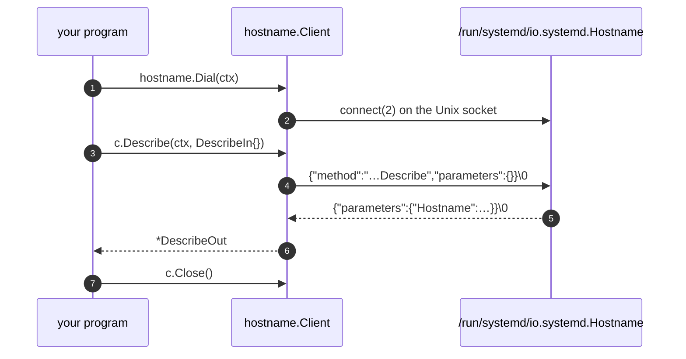

# Quickstart

In five minutes you'll ask `systemd-hostnamed` about your machine, the way
`hostnamectl` does, then resolve a name through `systemd-resolved` and handle
its typed errors. You need Go 1.24+ and a Linux host with systemd v257 or newer.

## 1. Create a module

```sh
mkdir hostinfo && cd hostinfo
go mod init example.com/hostinfo
go get github.com/rossedman/sdvarlink@latest
```

## 2. Write the program

```go title="main.go"
package main

import (
    "context"
    "errors"
    "fmt"
    "log"
    "time"

    "github.com/rossedman/sdvarlink/systemd/latest/hostname" // (1)!
    "github.com/rossedman/sdvarlink/varlink"
)

func main() {
    ctx, cancel := context.WithTimeout(context.Background(), 5*time.Second) // (2)!
    defer cancel()

    c, err := hostname.Dial(ctx) // (3)!
    if errors.Is(err, varlink.ErrUnsupported) {
        log.Fatal("systemd-hostnamed is not available here (systemd < v257?)")
    }
    if err != nil {
        log.Fatal(err)
    }
    defer c.Close()

    h, err := c.Describe(ctx, hostname.DescribeIn{}) // (4)!
    if err != nil {
        log.Fatal(err)
    }

    fmt.Println("Hostname:", h.Hostname)
    fmt.Println("OS:      ", varlink.Deref(h.OperatingSystemPrettyName)) // (5)!
    fmt.Println("Kernel:  ", h.KernelName, h.KernelRelease)
    fmt.Println("Machine: ", h.MachineID)
}
```

1.  One package per Varlink interface. `latest` follows the newest systemd
    release sdvarlink was generated from; `systemd/v257/hostname` would pin
    the v257 API instead.
2.  The context bounds the whole conversation: dialing, writing and waiting
    for the reply.
3.  `Dial` connects to the interface's well-known socket,
    `hostname.DefaultSocket` (`/run/systemd/io.systemd.Hostname`). Use
    `DialPath` for any other socket, such as a test fake.
4.  Every method takes a `context.Context` and, if the method has parameters,
    a `<Method>In` struct. It returns a `*<Method>Out`.
5.  Optional (`?string`) fields in the IDL are pointers in Go.
    `varlink.Deref` returns the value, or the zero value for `nil`.

## 3. Run it

```sh
go run .
```

```text title="Output (illustrative)"
Hostname: build-07
OS:       Fedora Linux 42 (Server Edition)
Kernel:   Linux 6.14.4-300.fc42.x86_64
Machine:  4b0e31a7c1f24f0c8f6d51c0b3a2e9d4
```

## What just happened



1. `Dial` opened a Unix socket straight to `systemd-hostnamed`. There's no bus
   and no broker in between.
2. `Describe` encoded `DescribeIn` as JSON, wrote it followed by a NUL byte, and
   waited for one NUL-terminated reply.
3. The reply was decoded into `DescribeOut`. If a newer systemd sends fields
   these bindings don't know, they land in `h.Extra` instead of being dropped.
4. `Close` released the client's connection pool.

## 4. Add a second service, and an error

Resolve names through `systemd-resolved`. A name that doesn't exist comes back
as a **typed error**:

```go title="resolve.go"
package main

import (
    "context"
    "errors"
    "fmt"
    "net/netip"

    "github.com/rossedman/sdvarlink/systemd/latest/resolve"
)

func lookup(ctx context.Context, name string) error {
    c, err := resolve.Dial(ctx)
    if err != nil {
        return err
    }
    defer c.Close()

    out, err := c.ResolveHostname(ctx, resolve.ResolveHostnameIn{Name: name})
    switch {
    case errors.Is(err, resolve.ErrNoSuchResourceRecord):
        fmt.Printf("%s: no such host\n", name)
        return nil
    case err != nil:
        return err
    }
    for _, a := range out.Addresses {
        b := make([]byte, len(a.Address))
        for i, v := range a.Address {
            b[i] = byte(v)
        }
        ip, _ := netip.AddrFromSlice(b)
        fmt.Printf("%-20s %s\n", out.Name, ip)
    }
    return nil
}
```

Call `lookup(ctx, "systemd.io")` from `main`, and try a name that doesn't
exist, such as `nope.invalid`.

```text title="Output (illustrative)"
systemd.io           185.199.108.153
systemd.io           185.199.109.153
nope.invalid: no such host
```

!!! tip "Stuck?"

    - **`permission denied`**: the method needs privileges. Retry with `sudo`, or
      see the [Security model](../guides/security.md).
    - **`varlink: service not available on this host`**: the socket doesn't
      exist. Check `ls /run/systemd/` and `systemctl status systemd-hostnamed`.
    - **`org.varlink.service.MethodNotFound`**: your systemd predates that
      method. See [feature detection](../guides/versioning.md#feature-detection).

## Where next

<div class="grid cards" markdown>

-   :material-school-outline: **Learn the protocol**

    ---

    Frames, `more`, `oneway`, errors, introspection and fds, in one page.

    [:octicons-arrow-right-24: Core concepts](concepts.md)

-   :material-waves: **Stream replies**

    ---

    List every user, unit or DNS query with `range`.

    [:octicons-arrow-right-24: Streaming](../guides/streaming.md)

-   :material-test-tube: **Test without systemd**

    ---

    Run the same code against a fake server in `go test`.

    [:octicons-arrow-right-24: Testing](../guides/testing.md)

-   :material-folder-play-outline: **Browse runnable examples**

    ---

    Fifteen programs, from `resolvectl query` to mounting disk images.

    [:octicons-arrow-right-24: Examples](../examples/index.md)

</div>
