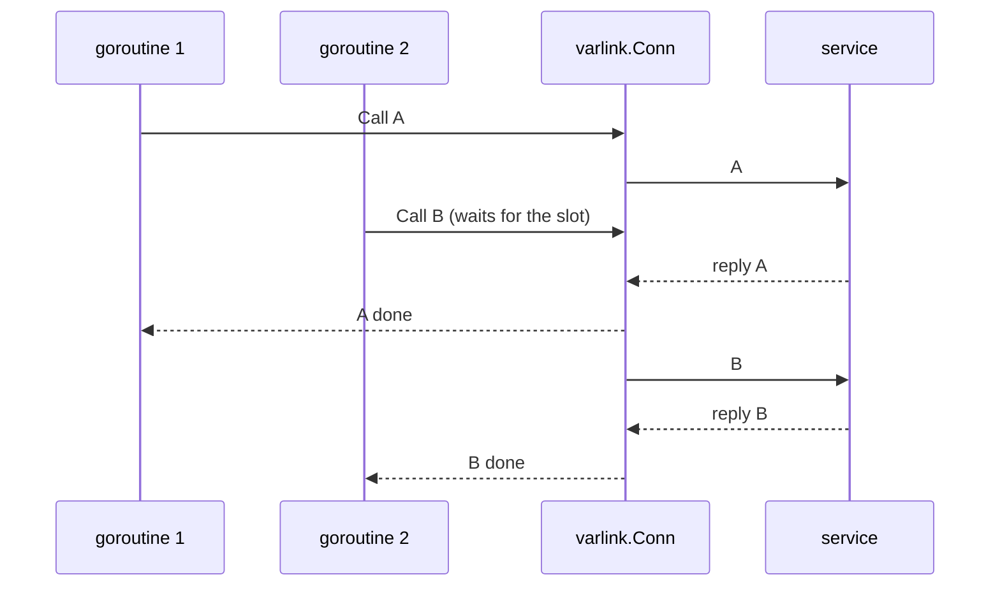

# Concurrency & pools

## One call per connection

The Varlink protocol answers calls on a connection **in order**, with no
request IDs. So a `varlink.Conn` runs one call at a time: a second goroutine
calling on the same `Conn` waits its turn (or until its context ends).



That's correct, but serial. For concurrency, use more connections.

## Pools

A `varlink.Pool` hands out connections to one service: idle ones are reused,
and new ones are dialed on demand. It implements the same `varlink.Caller`
interface as `Conn`, so it's a drop-in replacement:

```go
pool := varlink.NewPoolPath("/run/systemd/resolve/io.systemd.Resolve")
defer pool.Close()

var out json.RawMessage
err := pool.Call(ctx, "io.systemd.Resolve.ResolveHostname",
    map[string]string{"name": "example.com"}, &out)
```

| Constructor / option | What it does |
| --- | --- |
| `varlink.NewPoolPath(path, opts...)` | Pool that dials `path` with `varlink.Dial`, passing connection options. |
| `varlink.NewPool(dial, opts...)` | Pool with your own `DialFunc`, e.g. `varlink.DialService`, or a socket in a container. |
| `varlink.WithMaxIdle(n)` | Keep up to `n` idle connections (default `varlink.DefaultMaxIdle` = 4). Busy connections aren't limited. |
| `pool.Get(ctx)` / `pool.Put(c)` | Borrow a connection for several calls in a row; return it when done. |
| `pool.Close()` | Close idle connections; in-use ones close when returned. Later calls fail with `ErrClosed`. |

A pool never reuses a connection that failed: a `Conn` that hit a transport
error, a protocol error or an [abandoned stream](streaming.md#breaking-out-early)
is closed and discarded on `Put`.

## Generated clients pool by default

`pkg.Dial` and `pkg.DialPath` build a pool for you, so a generated client is
**safe for concurrent use** and goroutines don't queue behind each other. Share
one client across your program:

```go
c, err := resolve.Dial(ctx)
if err != nil {
    return err
}
defer c.Close()

names := []string{"github.com", "go.dev", "systemd.io", "kernel.org"}
var wg sync.WaitGroup
for _, name := range names {
    wg.Add(1)
    go func() {
        defer wg.Done()
        out, err := c.ResolveHostname(ctx, resolve.ResolveHostnameIn{Name: name})
        if err != nil {
            log.Printf("%s: %v", name, err)
            return
        }
        log.Printf("%s: %d addresses", name, len(out.Addresses))
    }()
}
wg.Wait()
```

Run the [concurrent lookups example](../examples/concurrent-lookups.md) to see
the effect: lookups overlap instead of adding up.

### Bounding concurrency

A pool dials as many connections as there are concurrent calls. If you fan
out to thousands of goroutines, bound them yourself, for example with a
semaphore, so you don't open thousands of sockets to a system service:

```go
// resolveAll resolves names with at most 8 calls in flight.
func resolveAll(ctx context.Context, c *resolve.Client, names []string) map[string]int {
    sem := make(chan struct{}, 8)
    var mu sync.Mutex
    counts := map[string]int{}
    var wg sync.WaitGroup
    for _, name := range names {
        wg.Add(1)
        go func() {
            defer wg.Done()
            sem <- struct{}{}
            defer func() { <-sem }()
            out, err := c.ResolveHostname(ctx, resolve.ResolveHostnameIn{Name: name})
            if err != nil {
                return
            }
            mu.Lock()
            counts[name] = len(out.Addresses)
            mu.Unlock()
        }()
    }
    wg.Wait()
    return counts
}
```

### Tuning or sharing the pool

`pkg.Dial` uses the default idle limit. To tune it, or to share one pool
between clients of interfaces served on the same socket (PID 1 serves both
`io.systemd.Manager` and `io.systemd.Unit` on `/run/systemd/io.systemd.Manager`),
build the pool and pass it to `New`:

```go
pool := varlink.NewPool(func(ctx context.Context) (*varlink.Conn, error) {
    return varlink.DialService(ctx, manager.DefaultSocket) // ErrUnsupported if missing
}, varlink.WithMaxIdle(8))
defer pool.Close()

mgr := manager.New(pool)
units := unit.New(pool) // same socket, same pool

d, err := mgr.Describe(ctx)
if err != nil {
    return err
}
fmt.Println("systemd", d.Runtime.Version)
for u, err := range units.ListMore(ctx, unit.ListIn{}) {
    if err != nil {
        return err
    }
    fmt.Println(u.Context.ID)
}
```

!!! note

    A client made with `New` doesn't own its `Caller`: `Close` on it is a
    no-op. Close the pool (or connection) you created.

## Using a single connection

Sometimes one connection is exactly what you want: a short-lived tool, or a
sequence of calls that should go over the same socket. `New` accepts a
`*varlink.Conn` too:

```go
conn, err := varlink.Dial(ctx, hostname.DefaultSocket)
if err != nil {
    return err
}
defer conn.Close()

c := hostname.New(conn) // every call on c uses this one connection
h, err := c.Describe(ctx, hostname.DescribeIn{})
if err != nil {
    return err
}
fmt.Println(h.Hostname)
```

`conn.Err()` returns `nil` while the connection is usable and the reason once
it isn't.

## Contexts and deadlines

Every call takes a `context.Context`, and it governs the **whole** exchange:
waiting for a free connection, writing the call, and reading every reply.

- A **deadline** is applied to the socket, so a hung service can't block you
  past it. The call returns `context.DeadlineExceeded`.
- **Cancellation** interrupts a blocked read or write immediately. The call
  returns `context.Canceled`.

<!-- check: var c *resolve.Client -->
```go
ctx, cancel := context.WithTimeout(ctx, 2*time.Second)
defer cancel()

_, err := c.ResolveHostname(ctx, resolve.ResolveHostnameIn{Name: "slow.example"})
if errors.Is(err, context.DeadlineExceeded) {
    log.Print("resolved didn't answer within 2s")
}
```

Varlink can't cancel a call on the server side, so a call abandoned
mid-flight leaves the connection out of step; sdvarlink closes it. With a pool
(or a generated client) the next call just uses another connection. A context
that ends while a call is still **waiting** for a connection slot doesn't
affect the connection at all.

!!! tip "Set a deadline on every call path"

    systemd services are usually fast, but a service that's starting up,
    stuck on a polkit prompt, or waiting on the network (resolved) can take a
    while. A deadline turns "hangs forever" into a clear error.

## See also

- [Example: concurrent lookups](../examples/concurrent-lookups.md)
- [Streaming: breaking out early](streaming.md#breaking-out-early)
- [`varlink.Pool` on pkg.go.dev](https://pkg.go.dev/github.com/rossedman/sdvarlink/varlink#Pool)
