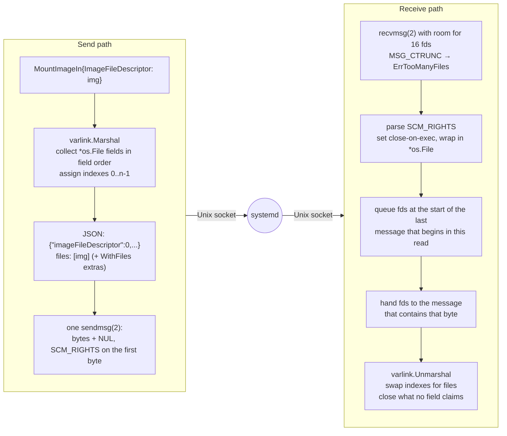

# File descriptors

Some systemd methods don't take paths; they take **open files**. 
`io.systemd.MountFileSystem.MountImage` takes a disk image as a file
descriptor and hands back one mount descriptor per partition.
`io.systemd.Machine.Open` returns a pseudo-terminal. `io.systemd.NamespaceResource`
takes user-namespace descriptors. Passing descriptors instead of paths means
no path races, and a caller can hand over exactly the access it holds.

Varlink carries descriptors next to a message as `SCM_RIGHTS` ancillary data,
and the JSON refers to them by **index**. sdvarlink does the bookkeeping: you
work with `*os.File`.

## Generated fd fields

The generator recognizes systemd's convention: an `int` field whose name ends
in `FileDescriptor` carries a descriptor index. It becomes an `*os.File` with a
`varlink` struct tag:

=== "IDL"

    ```text
    method MountImage(
        imageFileDescriptor: int,
        userNamespaceFileDescriptor: ?int,
        readOnly: ?bool,
        ...
        verityDataFileDescriptor: ?int,
        ...
    ) -> (
        partitions: []PartitionInfo,
        ...
    )

    type PartitionInfo(
        designator: PartitionDesignator,
        ...
        mountFileDescriptor: int,
        mountPoint: ?[]string
    )
    ```

=== "Generated Go"

    <!-- check:skip -->
    ```go
    type MountImageIn struct {
        ImageFileDescriptor         *os.File `json:"-" varlink:"imageFileDescriptor,fd"`
        UserNamespaceFileDescriptor *os.File `json:"-" varlink:"userNamespaceFileDescriptor,fd"`
        ReadOnly                    *bool    `json:"readOnly,omitempty"`
        // ...
    }

    type PartitionInfo struct {
        Designator          PartitionDesignator `json:"designator"`
        // ...
        MountFileDescriptor *os.File            `json:"-" varlink:"mountFileDescriptor,fd"`
        MountPoint          []string            `json:"mountPoint,omitempty"`
    }
    ```

The `json:"-"` keeps `encoding/json` away from the file; the
`varlink:"<name>,fd"` tag tells sdvarlink's codec to send it out of band and
write its index under `<name>`. Fd fields work at any depth: in nested structs,
slices (`[]PartitionInfo`) and maps.

## Ownership rules

| Direction | Who owns the `*os.File` | What you do |
| --- | --- | --- |
| **You send** (input fields, `WithFiles`) | **You.** sdvarlink borrows it for the duration of the `sendmsg(2)`. | Close it when you're done, typically with `defer`. |
| **You receive** (output fields) | **You**, once the reply is decoded. | Close each one. |
| **Received but unclaimed** (no field for it, reply discarded, decode error) | sdvarlink | Nothing: it's closed for you. |
| **Error reply** | sdvarlink | Nothing: any fds sent with an error are closed. |

```go
img, err := os.Open("app.raw")
if err != nil {
    return err
}
defer img.Close() // (1)!

c, err := mountfilesystem.Dial(ctx)
if err != nil {
    return err
}
defer c.Close()

out, err := c.MountImage(ctx, mountfilesystem.MountImageIn{
    ImageFileDescriptor: img,               // sent as SCM_RIGHTS, index 0
    ReadOnly:            varlink.Ptr(true),
})
if err != nil {
    return err
}
for _, p := range out.Partitions {
    defer p.MountFileDescriptor.Close() // (2)!
    fmt.Println(p.Designator, p.FileSystemType, p.MountFileDescriptor.Name())
}
```

1.  The input file is still yours after the call returns. sdvarlink never
    closes files you pass in.
2.  Every received descriptor is a new `*os.File` with close-on-exec set. It is
    yours: close it, or hand it to something that will (e.g. `move_mount(2)`
    via `golang.org/x/sys/unix`).

## How it works



**Sending.** `varlink.Marshal` walks the input depth first, collects non-nil
fd fields in field order, numbers them `0..n-1`, and writes those numbers into
the JSON. The message and its descriptors go out in a **single**
`sendmsg(2)`, with the descriptors attached to the message's first byte, the
same convention as systemd's own `sd-varlink`. Files passed with
`varlink.WithFiles` are appended after the field descriptors.

**Receiving.** A sender attaches descriptors to a `sendmsg` that starts with
the message referencing them, and puts no later message after it (sdvarlink
sends one message per `sendmsg`; systemd holds back further output until a
message with descriptors is flushed). The kernel ends a read right after the
chunk that carried descriptors, though it may put earlier, descriptor-less
data in front of it. So sdvarlink gives the descriptors to the **last message
that begins within the read** that returned them, and they stay with the
right reply even when several replies arrive in one read (as streams often
do). `varlink.Unmarshal` then replaces each index with its `*os.File`.
(On macOS and the BSDs, where you would only talk to a `varlinktest` fake,
the kernel starts such a read at the descriptor-carrying message instead,
and the transport uses that rule there.)

!!! note "systemd v257 and v258"

    These releases can append a descriptor-carrying reply to earlier unsent
    replies in one `sendmsg`. The rule above still gets that right unless the
    earlier replies exceed one kernel socket-buffer chunk (tens of KiB).
    Newer systemd never batches this way, and no systemd method that returns
    descriptors streams its replies, so the case does not arise in practice.

## Edge cases, handled

| Situation | Behavior |
| --- | --- |
| Peer sends more fds than the limit | The kernel truncates (`MSG_CTRUNC`); the call fails with `varlink.ErrTooManyFiles`, whatever arrived is closed, the connection is closed. |
| You send more fds than the limit | The call fails with `varlink.ErrTooManyFiles` before anything is written; the connection stays usable. |
| Two fields reference the same index | Each field gets its own descriptor (the second is a `dup`), so closing one doesn't break the other. |
| An index is out of range | Decoding fails with an error naming the field; all received fds are closed. |
| A descriptor nobody claims | Closed during decode. Nothing leaks, even if the schema doesn't match. |
| You pass `nil` for an fd field | The field is omitted from the JSON. For a required field, systemd answers `org.varlink.service.InvalidParameter`. |
| `exec` of a child process | Received fds have `FD_CLOEXEC` set, so they don't leak into children. |

!!! note "Tested for leaks"

    sdvarlink's tests count entries in `/proc/self/fd` across thousands of
    fd-passing calls, including calls whose replies are discarded, and fail if
    the count grows.

## Limits

By default a connection accepts at most **16 descriptors per read**
(`varlink.DefaultMaxFiles`) and sends at most 16 per message. Raise it for
methods that move many descriptors:

```go
c, err := mountfilesystem.Dial(ctx, varlink.WithMaxFiles(64))
if err != nil {
    return err
}
defer c.Close()
```

## Receiving a pseudo-terminal

`io.systemd.Machine.Open` allocates a PTY in a container and passes its
controlling side back:

```go
c, err := machine.Dial(ctx)
if err != nil {
    return err
}
defer c.Close()

out, err := c.Open(ctx, machine.OpenIn{
    Name: varlink.Ptr("web"),
    Mode: machine.MachineOpenModeShell,
    User: varlink.Ptr("root"),
    Path: varlink.Ptr("/bin/sh"),
    Args: []string{"/bin/sh", "-c", "uname -a"},
})
if err != nil {
    return err
}
pty := out.PtyFileDescriptor // *os.File, yours to close
defer pty.Close()

io.Copy(os.Stdout, pty) // read the command's output from the PTY
```

## Raw calls with descriptors

With the core package you can tag your own structs, or send extra files
positionally with `varlink.WithFiles`:

=== "Tagged struct"

    ```go
    type mountIn struct {
        Image    *os.File `json:"-" varlink:"imageFileDescriptor,fd"`
        ReadOnly bool     `json:"readOnly"`
    }
    type partition struct {
        Designator string   `json:"designator"`
        Mount      *os.File `json:"-" varlink:"mountFileDescriptor,fd"`
    }
    type mountOut struct {
        Partitions []partition `json:"partitions"`
    }

    func mount(ctx context.Context, conn *varlink.Conn, img *os.File) ([]partition, error) {
        var out mountOut
        err := conn.Call(ctx, "io.systemd.MountFileSystem.MountImage",
            mountIn{Image: img, ReadOnly: true}, &out)
        return out.Partitions, err // caller closes each p.Mount
    }
    ```

=== "WithFiles"

    <!-- check: var conn *varlink.Conn; var img *os.File -->
    ```go
    // Indexes for WithFiles start after any fd fields; with raw JSON that's 0.
    var out json.RawMessage
    err := conn.Call(ctx, "io.systemd.MountFileSystem.MountImage",
        json.RawMessage(`{"imageFileDescriptor":0,"readOnly":true}`), &out,
        varlink.WithFiles(img))
    if err != nil {
        return err
    }
    // Decoding into json.RawMessage claims no fds: they were closed for you.
    // To keep them, use CallReply and Reply.Files (see Raw calls).
    ```

To keep descriptors from a raw reply, use `CallReply`, whose `Reply.Files`
holds them until you `Decode` or `Close`. See
[Raw calls & the core package](raw-calls.md#streams-and-replies).

## Testing fd methods

`varlinktest` fakes pass descriptors too, so you can test fd-handling code
without root or systemd. See [Testing: file-descriptor fixtures](testing.md#file-descriptor-fixtures).

## See also

- [Example: Mount a disk image](../examples/mount-image.md)
- [`io.systemd.MountFileSystem` reference](../reference/interfaces/mountfilesystem.md)
- [Security model](security.md#file-descriptors)
