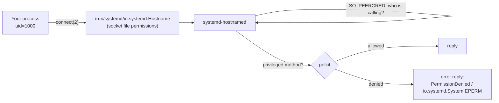

# Security model

As a client, sdvarlink adds **no privilege** and makes **no authorization
decisions**: it connects to sockets systemd created, sends what you ask, and
decodes what comes back, defensively. When you *serve* with `varlink.Server`,
authorization is yours: see [Serving a service](#serving-a-service) below.

## Authorization stays with systemd



1. **Socket permissions.** The kernel checks the socket file's mode and owner
   before `connect(2)` succeeds. Some sockets are root-only (for example
   journald's `/run/systemd/journal/io.systemd.journal` is mode `0600`).
2. **Peer credentials.** The service reads the caller's UID, GID and PID from
   the socket (`SO_PEERCRED`). sdvarlink can't forge them, and doesn't try.
3. **polkit.** For privileged operations, the service asks polkit. Methods with
   an `allowInteractiveAuthentication` parameter can trigger an interactive
   prompt if you set it to `true`; it defaults to `false`.

So a program built with sdvarlink can do exactly what `varlinkctl` run as the
same user can do. Denials arrive as errors you can match:

<!-- check: var c *journal.Client -->
```go
err := c.Rotate(ctx)
if errors.Is(err, varlink.ErrPermissionDenied) || errors.Is(err, syscall.EPERM) || errors.Is(err, syscall.EACCES) {
    return fmt.Errorf("rotate needs root or a polkit grant: %w", err)
}
```

## Limits on what a peer can send

A misbehaving or compromised peer can't make your process allocate without
bound:

| Limit | Default | Option | On violation |
| --- | --- | --- | --- |
| Message (frame) size | 16 MiB (`varlink.DefaultMaxFrameSize`) | `varlink.WithMaxFrameSize(n)` | `varlink.ErrFrameTooLarge`; connection closed |
| File descriptors per read | 16 (`varlink.DefaultMaxFiles`) | `varlink.WithMaxFiles(n)` | `varlink.ErrTooManyFiles`; received fds closed; connection closed |
| Malformed JSON / protocol violations | n/a | n/a | `*varlink.ProtocolError`; connection closed |

```go
// Tighter limits for a service you only expect small replies from.
c, err := hostname.Dial(ctx, varlink.WithMaxFrameSize(1<<20), varlink.WithMaxFiles(0))
if err != nil {
    return err
}
defer c.Close()
```

Use contexts with deadlines so a stalled peer can't block you indefinitely;
see [Concurrency: contexts and deadlines](concurrency.md#contexts-and-deadlines).

## Decoding

- Replies are decoded into generated structs with `encoding/json`. Fields
  the bindings don't know are **kept** in each struct's `Extra` map, never
  silently dropped and never interpreted.
- Optional fields are pointers, so "absent" is distinguishable from "zero".
- Type mismatches are decode errors, not silent coercions.
- Error parameters for unknown error names stay raw (`*varlink.Error.Parameters`)
  until you decode them.

## File descriptors

Descriptors are capabilities, so sdvarlink is strict about them:

- **Received descriptors get `FD_CLOEXEC`** immediately, so they can't leak into
  child processes you `exec`.
- **Unclaimed descriptors are closed.** A reply's descriptors are given only to
  the fd fields that reference them; any others, including those attached to
  error replies, or to replies you discard, are closed.
- **Every error path closes what it received**: truncated ancillary data
  (`MSG_CTRUNC`), bad indexes, decode failures. Tests count open descriptors
  across thousands of calls to enforce this.
- **Descriptors you send stay yours.** sdvarlink never closes, duplicates or
  retains them past the `sendmsg(2)`.

See [File descriptors](file-descriptors.md) for the full ownership rules.

## Logging

sdvarlink **logs nothing**. Parameters can hold secrets, such as passwords for
`io.systemd.MountFileSystem.MountImage`, credentials for `io.systemd.Credentials`
or user records, so the library never writes parameters, replies or errors
anywhere. If you log errors, remember that a `*varlink.Error`'s message
includes its parameters.

## Transport scope

sdvarlink speaks Varlink over **local Unix sockets only**. There is no TCP, TLS
or remote transport, and no `org.varlink.resolver`: systemd uses fixed socket
paths. For remote access, put a purpose-built bridge (such as
`varlink-http-bridge`) and its own authentication in front.

## Dependencies and supply chain

The runtime depends on the Go standard library and `golang.org/x/sys` only,
with no cgo. Generated code is checked in and reviewed like any other code,
and CI fails if it drifts from what the generator produces
(`make check-generated`).

## Reporting a vulnerability

Please report security issues privately through
[GitHub security advisories](https://github.com/rossedman/sdvarlink/security/advisories/new)
rather than in a public issue.

## Serving a service

When your program serves Varlink with `varlink.Server`, the roles flip:
clients are untrusted input and your handlers decide who may do what.

- **Authorize in the handler.** `call.Peer()` gives the caller's UID, GID and
  PID from `SO_PEERCRED`. Decide on UID and GID; PIDs are reused. Return
  `varlink.ErrPermissionDenied` to refuse.
- **Restrict the socket.** Set `SocketMode=` and `SocketGroup=` in the
  `.socket` unit, or `varlink.WithSocketMode` / `varlink.WithSocketOwner`
  with `varlink.Listen` (default mode `0660`), so only the right users can
  connect at all.
- **Parameters are validated before handlers run**, against the IDL: missing,
  mistyped and unknown fields are refused with `InvalidParameter`.
- **Internal errors don't leak.** A handler error that is not a Varlink error
  reaches the client as `io.systemd.System` `EIO`; the detail goes to the log.
  Panics are recovered the same way.
- **Resource limits.** Calls over 16 MiB close the connection, at most 16
  descriptors are accepted per read, and at most 256 connections are served
  at once (`WithServerMaxFrameSize`, `WithServerMaxFiles`,
  `WithMaxConnections`). `WithIdleTimeout` closes idle connections.
- **No parameter logging.** The server logs method names and errors, never
  call parameters.
