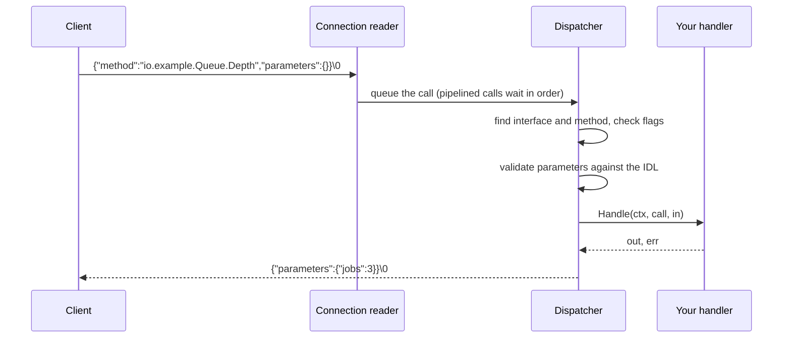
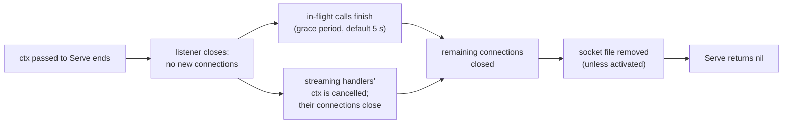

# Serving Varlink

sdvarlink's `varlink` package serves interfaces as well as calling them. A
`Server` holds interfaces; each interface is registered with its IDL text; each
method gets a typed Go handler. The server answers introspection, validates
parameters against the IDL and behaves like systemd's own sd-varlink, so
`varlinkctl` and systemd's tooling treat a Go service exactly like a C one.

```go
//go:embed io.example.Queue.varlink
var queueIDL string

srv := varlink.NewServer(varlink.ServerInfo{
    Vendor: "Example", Product: "queued", Version: "1.2.0", URL: "https://example.com",
})
iface := srv.Interface("io.example.Queue", queueIDL)

varlink.Handle(iface, "Depth", func(ctx context.Context, call *varlink.Call, _ struct{}) (DepthOut, error) {
    return DepthOut{Jobs: q.Len()}, nil
})

l, err := varlink.Listen("/run/queued/io.example.Queue")
if err != nil {
    return err
}
return srv.Serve(ctx, l) // returns after ctx ends and in-flight calls drain
```

## How a call is served



Each connection has a reader goroutine and a dispatcher. Calls on one
connection run one at a time, in order, so a client may pipeline calls and get
replies back in the same order. Different connections run concurrently. The
reader keeps reading while a handler runs, so a client that disconnects
cancels its handler's `ctx` right away. A client that only closes its write
side after sending its calls (as `socat` or a shell pipe does) is still
answered; the connection closes once its queued calls are done.

## Registering interfaces and handlers

`srv.Interface(name, idl)` parses the IDL. The text you pass is exactly what
`GetInterfaceDescription` returns, so introspection always matches what you
serve. Embed it from a `.varlink` file next to your code.

Handlers are generic functions, checked against the IDL when you register
them:

| Function | Use it for | Handler signature |
| --- | --- | --- |
| `varlink.Handle` | Methods with one reply | `func(ctx, *varlink.Call, In) (Out, error)` |
| `varlink.HandleStream` | Methods that stream (`more`) | `func(ctx, *varlink.Call, In, send func(Out) error) error` |

`In` and `Out` are structs whose JSON field names match the IDL. Use `struct{}`
for methods without parameters or reply fields. The usual mapping applies:
`?T` fields are pointers (or slices and maps) with `omitempty`, enums are
strings, `object` and `any` are `json.RawMessage`.

!!! tip "Fail at startup, not in production"

    Registration panics when the handler cannot serve the method: the method is
    not in the IDL, a Go field is not in the IDL, a field's Go type disagrees
    with its IDL type, the reply type lacks a required field, or a method that
    requires `more` is registered with `Handle`. Mismatches never reach
    clients.

Methods declared in the IDL without a handler answer
`org.varlink.service.MethodNotImplemented`, so you can serve an interface
before implementing all of it.

### Serving a systemd interface with generated types

The generated packages work on the server side too: their `<Method>In` and
`<Method>Out` types are your handler's types, and `InterfaceDescription` is the
IDL to register.

```go
import "github.com/rossedman/sdvarlink/systemd/v260/metrics"

iface := srv.Interface(metrics.InterfaceName, metrics.InterfaceDescription)
varlink.HandleStream(iface, "List", func(ctx context.Context, call *varlink.Call, _ struct{}, send func(metrics.ListOut) error) error {
    return send(metrics.ListOut{Name: "io.example.App.requests", Value: json.RawMessage("42")})
}, varlink.LastIsFinal())
```

See [Publish metrics](../examples/metrics-provider.md) for a complete
`io.systemd.Metrics` provider.

## Streaming replies

A `HandleStream` handler gets a `send` function. Which mode to use depends on
whether the stream is a finite list or an open-ended feed:

=== "Live stream (default)"

    Each `send` writes a reply with `"continues": true` immediately. When the
    handler returns, an empty final reply ends the stream. Use this for
    subscriptions and event feeds, where each event must reach the client as
    soon as it happens.

    ```go
    varlink.HandleStream(iface, "Watch", func(ctx context.Context, call *varlink.Call, in WatchIn, send func(WatchOut) error) error {
        for {
            select {
            case ev := <-events:
                if err := send(WatchOut{Event: ev}); err != nil {
                    return err // the client is gone
                }
            case <-ctx.Done(): // client disconnected or server shutting down
                return nil
            }
        }
    })
    ```

=== "Finite list (LastIsFinal)"

    With `varlink.LastIsFinal()`, each reply is held until the next `send` (or
    the handler's return) shows whether more follow, so the last value *is* the
    final reply. This is what sd-varlink does for list replies, and it means
    clients never see a trailing empty item. Use it for methods such as
    `io.systemd.Metrics.List` that return a known set of results.

    ```go
    varlink.HandleStream(iface, "List", func(ctx context.Context, call *varlink.Call, _ struct{}, send func(Item) error) error {
        for _, it := range items {
            if err := send(it); err != nil {
                return err
            }
        }
        return nil
    }, varlink.LastIsFinal())
    ```

!!! warning "Only send while the handler runs"

    `send` fails once the handler has returned, so a goroutine the handler
    started cannot write into a later call's replies. Wait for such
    goroutines before returning.

If the handler's `ctx` ends (the client disconnected or the server is
shutting down) and it returns, the server closes the connection without a
final reply, as sd-varlink does, rather than end the stream with a reply
the client did not expect.

A call to a streaming method without the `more` flag gets
`org.varlink.service.ExpectedMore`. Add `varlink.AllowSingle()` to answer such
calls with the first value sent instead. Methods the IDL marks
`# [Requires 'more' flag]` always need `more`.

## Errors

Return an error from a handler and the server turns it into a Varlink error:

| Handler returns | Client receives |
| --- | --- |
| `*varlink.Error{Name, Parameters}` | that error, as is |
| A type with `VarlinkError() string`, such as a generated `*resolve.NoNameServersError` | that error name, with the value's JSON fields as parameters |
| `varlink.ErrPermissionDenied` (and the other `org.varlink.service` sentinels) | the standard error |
| An error wrapping a `syscall.Errno` | `io.systemd.System` with `errno` and `errnoName` |
| Any other error, or a panic | `io.systemd.System` with `EIO`. The error and stack are logged; nothing leaks to the client |

The last two rows match sd-varlink, which reports failing method callbacks as
`io.systemd.System` errors. sdvarlink's own client unwraps them, so
`errors.Is(err, syscall.EIO)` works on the calling side.

The server answers these before your handler runs:

| Condition | Error |
| --- | --- |
| Interface not registered | `org.varlink.service.InterfaceNotFound` with `interface` |
| Method not in the IDL | `org.varlink.service.MethodNotFound` with `method` |
| Method in the IDL, no handler | `org.varlink.service.MethodNotImplemented` with `method` |
| Missing required field, wrong type, unknown enum value, or a field the IDL does not define | `org.varlink.service.InvalidParameter` with `parameter` |
| Streaming method called without `more` | `org.varlink.service.ExpectedMore` |
| `upgrade` requested | `org.varlink.service.MethodNotImplemented` |

Unknown fields are rejected, as sd-varlink does. Register a method with
`varlink.AllowUnknownFields()` to accept them, for example while clients roll
out a parameter your IDL does not have yet.

## Authorization with peer credentials

The server adds no access control of its own; your handler decides. `call.Peer()`
returns the caller's UID, GID and PID, read once per connection with
`SO_PEERCRED`. Authorize on UID and GID; PIDs are informational because they
are reused.

```go
varlink.Handle(iface, "Enqueue", func(ctx context.Context, call *varlink.Call, in EnqueueIn) (EnqueueOut, error) {
    peer, err := call.Peer()
    if err != nil {
        return EnqueueOut{}, err
    }
    if peer.UID != 0 && int(peer.UID) != os.Getuid() {
        return EnqueueOut{}, varlink.ErrPermissionDenied
    }
    // ...
})
```

Combine this with socket permissions (`SocketMode=`, `SocketGroup=` in a
`.socket` unit, or `varlink.WithSocketMode` and `varlink.WithSocketOwner`) so
that only the right users can connect at all.

## File descriptors

Handlers send and receive files the same way clients do: `*os.File` fields
tagged `varlink:"name,fd"` in `In` and `Out`.

- Files a handler receives are its to close.
- Files in a reply are closed by the server once they are sent, including when
  the client has gone away. A reply with more files than
  `WithServerMaxFiles` allows is refused before anything is written: the call
  gets `io.systemd.System` `EIO` and the connection stays up.
- Descriptors no field claims are closed; the per-message limit is
  `varlink.WithServerMaxFiles` (default 16).

## Sockets and lifecycle

The same binary should work as a socket-activated unit and from a terminal.
Prefer the socket systemd passes, and fall back to binding the path:

```go
l, err := varlink.ListenActivated("")
if errors.Is(err, varlink.ErrNotActivated) {
    l, err = varlink.Listen("/run/queued/io.example.Queue")
}
```

- **`varlink.Listen(path, opts...)`** creates missing parent directories
  (`0755`), replaces a stale socket file left by a crashed run, refuses a path
  where another server is listening, and sets the socket mode (default `0660`)
  and optional owner. The socket is created with its final permissions in a
  private directory and renamed into place, and a `.<name>.lock` file next to
  it serializes concurrent starts. The socket file is removed when the server
  stops.
- **`varlink.ListenActivated(name)`** adopts a socket from `$LISTEN_FDS`. With
  several sockets, `name` picks one by its `FileDescriptorName=`, so one daemon
  can serve, say, an API socket and a `/run/systemd/report/` metrics socket.
  Activated sockets belong to systemd and are left in place.
- **Any `*net.UnixListener`** works with `Serve`, which keeps tests simple.

```ini
# queued.socket
[Socket]
ListenStream=/run/queued/io.example.Queue
SocketMode=0660
SocketGroup=queue-admins

# queued.service
[Service]
ExecStart=/usr/bin/queued
```

### Shutdown



Connections take no new calls once shutdown begins, even calls a client
already pipelined. Handlers that ignore their context after the grace period
cannot be stopped; `Serve` logs a warning and returns without them.

## Limits and options

| Option | Default | Effect |
| --- | --- | --- |
| `WithServerMaxFrameSize(n)` | 16 MiB | Larger calls get `io.systemd.System` `ENOBUFS` and the connection closes |
| `WithServerMaxFiles(n)` | 16 | Descriptors accepted with one read, and sent with one reply |
| `WithMaxConnections(n)` | 256 | Connections beyond this are closed on accept. Temporary accept failures (such as running out of descriptors) are retried with backoff |
| `WithIdleTimeout(d)` | off | Close connections with no call in flight for `d` |
| `WithShutdownGrace(d)` | 5 s | How long in-flight calls may run after shutdown begins |
| `WithLogger(l)` | `slog.Default()` | Where handler errors, panics and protocol problems go. Parameters are never logged |

## Testing a server

`Serve` takes any Unix listener, so a test can run the real server on a
temporary socket and call it with the real client:

```go
func TestDepth(t *testing.T) {
    srv := newServer() // registers interfaces and handlers
    path := filepath.Join(t.TempDir(), "queue")
    l, err := varlink.Listen(path)
    if err != nil {
        t.Fatal(err)
    }
    ctx, cancel := context.WithCancel(context.Background())
    defer cancel()
    go srv.Serve(ctx, l)

    c, err := varlink.Dial(ctx, path)
    if err != nil {
        t.Fatal(err)
    }
    defer c.Close()
    var out DepthOut
    if err := c.Call(ctx, "io.example.Queue.Depth", nil, &out); err != nil {
        t.Fatal(err)
    }
}
```

!!! note "Socket path length"

    Unix socket paths are limited to 108 bytes, and `t.TempDir()` can exceed
    that for long test names. Use `os.MkdirTemp("", "x")` if you hit
    `bind: invalid argument`.

`varlinktest` remains the tool for faking a service your code *calls*; the
`Server` is for code that *serves*.

## See also

- [Example: a job queue service](../examples/queued.md)
- [Example: publish metrics](../examples/metrics-provider.md)
- [Errors](errors.md) for the client side of error handling
- [`varlink` on pkg.go.dev](https://pkg.go.dev/github.com/rossedman/sdvarlink/varlink)
