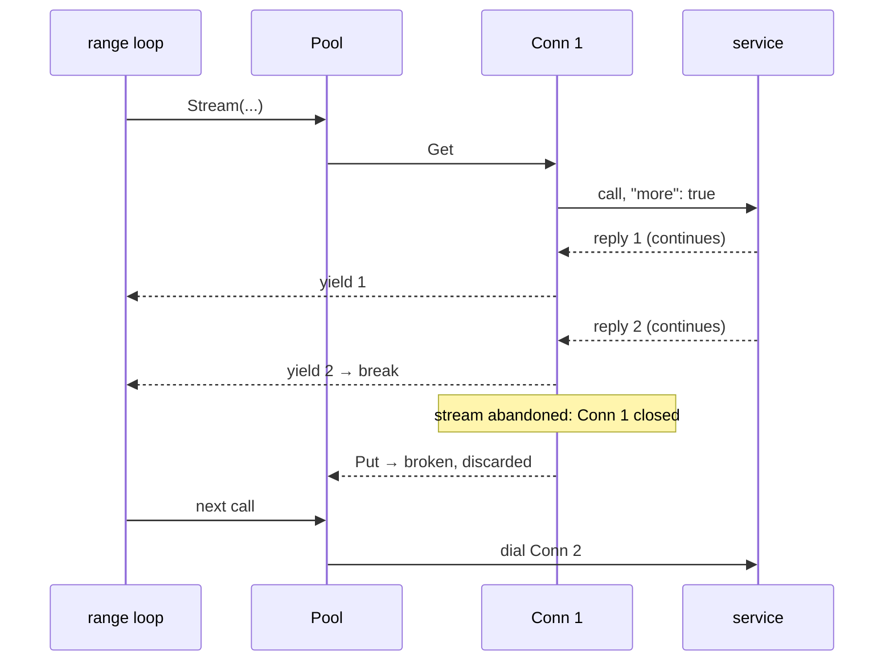

# Streaming with iterators

Some Varlink methods answer with **many replies**: every user in the user
database, every unit, every DNS query as it happens. The client asks for this
by setting `"more": true`, and the service marks each reply but the last with
`"continues": true`.

sdvarlink turns those streams into Go 1.23+ iterators, `iter.Seq2[*T, error]`,
so you consume them with a plain `range` loop.

## Which methods stream

systemd annotates streaming methods in its IDL, and the generator follows:

| IDL | Generated | Example |
| --- | --- | --- |
| `# [Requires 'more' flag]` | `X(ctx, in) iter.Seq2[*XOut, error]` | `resolvemonitor.Client.SubscribeQueryResults`, `metrics.Client.List`, `resolve.Client.BrowseServices` |
| `# [Supports 'more' flag]` | `X(ctx, in) (*XOut, error)` **and** `XMore(ctx, in) iter.Seq2[*XOut, error]` | `userdatabase.Client.GetUserRecord` / `GetUserRecordMore`, `unit.Client.List` / `ListMore`, `machine.Client.List` / `ListMore` |

The [interface reference](../reference/interfaces.md) marks streaming methods
with :material-waves:.

## The basic loop

```go
c, err := userdatabase.Dial(ctx)
if err != nil {
    return err
}
defer c.Close()

in := userdatabase.GetUserRecordIn{Service: "io.systemd.Multiplexer"}
for out, err := range c.GetUserRecordMore(ctx, in) {
    if err != nil {
        return err // a transport error, or an error reply that ended the stream
    }
    var u struct {
        UserName string `json:"userName"`
        UID      int    `json:"uid"`
    }
    if err := json.Unmarshal(out.Record, &u); err != nil {
        return err
    }
    fmt.Printf("%-16s %d\n", u.UserName, u.UID)
}
```

The rules of the sequence:

- Each iteration yields either a reply (`out != nil, err == nil`) or an error
  (`out == nil, err != nil`). After an error the sequence ends.
- The loop ends normally after the reply that doesn't continue.
- The sequence is **lazy**: the call is sent when the loop starts, not when
  you call `GetUserRecordMore`. Ranging twice sends the call twice.

## Supports-more: one reply or many

For `Supports 'more'` methods, pick the variant that matches your intent:

=== "One record"

    <!-- check: var c *userdatabase.Client -->
    ```go
    // Without "more": exactly one reply.
    out, err := c.GetUserRecord(ctx, userdatabase.GetUserRecordIn{
        UserName: varlink.Ptr("ross"),
        Service:  "io.systemd.Multiplexer",
    })
    if err != nil {
        return err
    }
    fmt.Printf("%s\n", out.Record)
    ```

=== "All records"

    <!-- check: var c *userdatabase.Client -->
    ```go
    // With "more": one reply per user.
    for out, err := range c.GetUserRecordMore(ctx, userdatabase.GetUserRecordIn{
        Service: "io.systemd.Multiplexer",
    }) {
        if err != nil {
            return err
        }
        fmt.Printf("%s\n", out.Record)
    }
    ```

!!! note "Empty results: no values, or an error"

    Most services answer "nothing to list" with a single empty final reply,
    which ends the stream without yielding anything, so the loop body never
    runs. Some report it as an error reply instead. `systemd-machined` answers `ListMore` with
    `io.systemd.Machine.NoSuchMachine` when no machines are registered;
    userdb uses `io.systemd.UserDatabase.NoRecordFound`. Treat those as an
    empty result:

    <!-- check: var c *machine.Client -->
    ```go
    for m, err := range c.ListMore(ctx, machine.ListIn{}) {
        if errors.Is(err, machine.ErrNoSuchMachine) {
            break // nothing registered
        }
        if err != nil {
            return err
        }
        fmt.Println(m.Name, m.Class)
    }
    ```

## Collecting, filtering, transforming

Iterators compose with ordinary Go. A small generic helper collects a stream
into a slice:

```go
// Collect drains seq into a slice, stopping at the first error.
func Collect[T any](seq iter.Seq2[*T, error]) ([]*T, error) {
    var out []*T
    for v, err := range seq {
        if err != nil {
            return out, err
        }
        out = append(out, v)
    }
    return out, nil
}
```

<!-- check: var c *unit.Client; var Collect func(iter.Seq2[*unit.ListOut, error]) ([]*unit.ListOut, error) -->
```go
units, err := Collect(c.ListMore(ctx, unit.ListIn{}))
if err != nil {
    return err
}
fmt.Println(len(units), "units")
```

Filter inline, or wrap the sequence in your own iterator:

```go
// failedUnits yields only units whose ActiveState is "failed".
func failedUnits(ctx context.Context, c *unit.Client) iter.Seq2[*unit.ListOut, error] {
    return func(yield func(*unit.ListOut, error) bool) {
        for u, err := range c.ListMore(ctx, unit.ListIn{}) {
            if err != nil {
                yield(nil, err)
                return
            }
            if varlink.Deref(u.Runtime.ActiveState) != "failed" {
                continue
            }
            if !yield(u, nil) {
                return // the consumer broke out: stop, which closes the stream
            }
        }
    }
}
```

## Breaking out early

You can `break` (or `return`) out of a stream at any point:

<!-- check: var c *userdatabase.Client; var in userdatabase.GetUserRecordIn -->
```go
for out, err := range c.GetUserRecordMore(ctx, in) {
    if err != nil {
        return err
    }
    if bytes.Contains(out.Record, []byte(`"userName":"ross"`)) {
        fmt.Println("found ross")
        break // stop reading the stream
    }
}
```

Varlink has **no way to cancel a call**. When you stop early, the service may
still be sending replies, and the connection's position in the stream is lost.
So sdvarlink **closes that connection**. With a generated client, which uses a
pool, the closed connection is dropped from the pool and the next call dials a
fresh one; you don't need to do anything.



!!! warning "Holding a single `*varlink.Conn`?"

    If you drive streams on your own `varlink.Conn` (not a pool or generated
    client), an abandoned stream leaves that `Conn` closed: later calls fail
    with an error, and `conn.Err()` reports why. Dial a new one, or use a
    [`Pool`](concurrency.md#pools).

If the stream runs to completion, or ends with an **error reply**, the
connection stays healthy and is reused.

!!! danger "Don't call the same `Conn` inside its own stream loop"

    A stream holds its connection until it ends. A call on the **same**
    `*varlink.Conn` from inside the loop waits for that connection forever (or
    until its context ends). Pools and generated clients don't have this
    problem: the inner call gets another connection.

    <!-- check: var c *unit.Client -->
    ```go
    // Fine: c is a generated client, so the inner call uses a second connection.
    for u, err := range c.ListMore(ctx, unit.ListIn{}) {
        if err != nil {
            return err
        }
        detail, err := c.List(ctx, unit.ListIn{Name: varlink.Ptr(u.Context.ID)})
        if err != nil {
            return err
        }
        _ = detail
    }
    ```

## Timeouts and cancellation

The context covers the whole stream. Cancel it, or let its deadline pass, and
the loop yields the context's error and ends; the connection is closed for
the same reason as above.

```go
// Give the whole listing ten seconds.
ctx, cancel := context.WithTimeout(context.Background(), 10*time.Second)
defer cancel()

c, err := unit.Dial(ctx)
if err != nil {
    return err
}
defer c.Close()

n := 0
for _, err := range c.ListMore(ctx, unit.ListIn{}) {
    if errors.Is(err, context.DeadlineExceeded) {
        return fmt.Errorf("listing units timed out after %d", n)
    }
    if err != nil {
        return err
    }
    n++
}
```

## Long-lived subscriptions

Subscription methods such as `io.systemd.Resolve.Monitor.SubscribeQueryResults`
never send a final reply; they stream until you stop. Tie them to a context
you cancel on shutdown:

```go
// Stream every DNS query systemd-resolved answers until Ctrl-C.
ctx, stop := signal.NotifyContext(context.Background(), os.Interrupt)
defer stop()

c, err := resolvemonitor.Dial(ctx)
if err != nil {
    return err
}
defer c.Close()

for ev, err := range c.SubscribeQueryResults(ctx, resolvemonitor.SubscribeQueryResultsIn{}) {
    if ctx.Err() != nil {
        return nil // interrupted: normal shutdown
    }
    if err != nil {
        return err
    }
    if varlink.Deref(ev.Ready) {
        continue // the first reply only says "subscribed"
    }
    for _, q := range ev.Question {
        fmt.Println(varlink.Deref(ev.State), q.Name)
    }
}
```

A subscription holds its connection for as long as it runs. Generated clients
pool connections, so other calls on the same client keep working meanwhile.

!!! tip "Reconnect loops"

    For a monitor that should survive a service restart, wrap the loop in a
    retry with backoff. A restarted service closes the socket, so the stream
    ends with an I/O error, and dialing again reaches the new instance.

## Raw streams

Without generated bindings, `Conn.Stream` / `Pool.Stream` yield
`*varlink.Reply`, and `varlink.StreamAs[T]` decodes each into your own type:

```go
type metric struct {
    Name   string          `json:"name"`
    Object string          `json:"object,omitempty"`
    Value  json.RawMessage `json:"value"`
}

func printMetrics(ctx context.Context, socket string) error {
    conn, err := varlink.Dial(ctx, socket) // e.g. /run/systemd/report/io.systemd.Network
    if err != nil {
        return err
    }
    defer conn.Close()

    for m, err := range varlink.StreamAs[metric](conn.Stream(ctx, "io.systemd.Metrics.List", nil)) {
        if err != nil {
            return err
        }
        fmt.Println(m.Name, m.Object, string(m.Value))
    }
    return nil
}
```

If you range over `Stream` directly, each `*varlink.Reply` may carry file
descriptors: call `r.Decode(&v)` to claim them, or `r.Close()` to release
them. See [Raw calls](raw-calls.md#streams-and-replies).

## See also

- Examples: [List users](../examples/list-users.md), [List units](../examples/list-units.md),
  [Monitor DNS](../examples/dns-monitor.md), [Read metrics](../examples/metrics.md)
- [Testing streaming handlers](testing.md#streaming-fakes)
