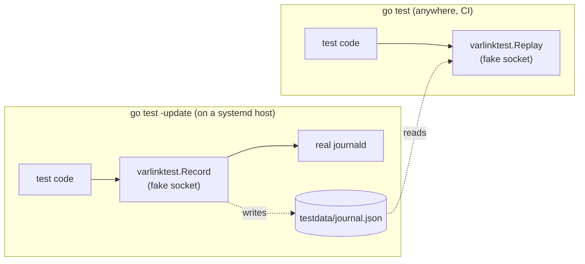

# Testing with varlinktest

Code that talks to systemd is usually hard to test: you need root, the right
systemd version, and a host you're allowed to change. `varlinktest` removes
all three. It runs a **fake Varlink service on a temporary Unix socket**,
answering from handlers you register. Your code connects to it exactly as it
would to systemd: same wire protocol, same fd passing, same errors.

```go
func TestResolve(t *testing.T) {
    srv := varlinktest.NewServer(t) // (1)!
    srv.Handle("io.systemd.Resolve.ResolveHostname", // (2)!
        func(in resolve.ResolveHostnameIn) (resolve.ResolveHostnameOut, error) {
            return resolve.ResolveHostnameOut{
                Name:      in.Name,
                Addresses: []resolve.ResolvedAddress{{Family: 2, Address: []int64{127, 0, 0, 1}}},
            }, nil
        })

    c, err := resolve.DialPath(context.Background(), srv.Path()) // (3)!
    if err != nil {
        t.Fatal(err)
    }
    defer c.Close()

    out, err := c.ResolveHostname(context.Background(), resolve.ResolveHostnameIn{Name: "db.internal"})
    if err != nil {
        t.Fatal(err)
    }
    if out.Name != "db.internal" || len(out.Addresses) != 1 {
        t.Fatalf("out = %+v", out)
    }
}
```

1.  Listens on a fresh socket under the system temp dir and shuts down, closing
    every connection, when the test ends (`t.Cleanup`).
2.  Handlers are keyed by the fully qualified method name.
3.  Point the code under test at `srv.Path()` instead of the default socket.
    That's the only seam you need.

!!! tip "Design for the seam"

    Accept a client (or a `varlink.Caller`) instead of dialing inside your
    functions, as the [testing-with-fake example](../examples/testing-with-fake.md)
    does with its `Resolver{Client: ...}` struct. Production code passes
    `resolve.Dial(ctx)`; tests pass `resolve.DialPath(ctx, srv.Path())`.

## Registering handlers

Three styles, from most convenient to most control:

=== "Handle (reflection)"

    `Handle` accepts a function of any of these shapes, where `In` and `Out`
    are structs (or pointers to structs):

    <!-- check:skip -->
    ```go
    func(In) (Out, error)
    func(context.Context, In) (Out, error)
    func(context.Context, In) iter.Seq2[Out, error] // streaming
    ```

    <!-- check: var srv *varlinktest.Server -->
    ```go
    srv.Handle("io.systemd.Hostname.Describe",
        func(hostname.DescribeIn) (hostname.DescribeOut, error) {
            return hostname.DescribeOut{
                Hostname:      "test-host",
                KernelName:    "Linux",
                KernelRelease: "6.14.0",
                MachineID:     "4b0e31a7c1f24f0c8f6d51c0b3a2e9d4",
            }, nil
        })
    ```

    A mismatched signature panics at registration, so mistakes show up on the
    first run.

=== "On / OnStream (generics)"

    The generic functions are checked at **compile time**:

    <!-- check: var srv *varlinktest.Server -->
    ```go
    varlinktest.On(srv, "io.systemd.Hostname.Describe",
        func(ctx context.Context, in hostname.DescribeIn) (hostname.DescribeOut, error) {
            return hostname.DescribeOut{Hostname: "test-host"}, nil
        })

    varlinktest.OnStream(srv, "io.systemd.UserDatabase.GetUserRecord",
        func(ctx context.Context, in userdatabase.GetUserRecordIn) iter.Seq2[userdatabase.GetUserRecordOut, error] {
            return func(yield func(userdatabase.GetUserRecordOut, error) bool) {
                yield(userdatabase.GetUserRecordOut{Record: json.RawMessage(`{"userName":"root"}`)}, nil)
            }
        })
    ```

=== "HandleRaw"

    Raw handlers see the call as received and write `Response`s, so you can
    send any JSON, including fields the bindings don't know:

    <!-- check: var srv *varlinktest.Server -->
    ```go
    srv.HandleRaw("io.systemd.Resolve.ResolveHostname",
        func(ctx context.Context, call *varlinktest.Call) iter.Seq2[*varlinktest.Response, error] {
            return func(yield func(*varlinktest.Response, error) bool) {
                // call.Method, call.Parameters, call.More, call.Oneway, call.Files
                yield(&varlinktest.Response{Parameters: json.RawMessage(
                    `{"name":"a","flags":1,"addresses":[],"addedInSystemd300":true}`)}, nil)
            }
        })
    ```

    That's how sdvarlink's own tests check that unknown fields land in `Extra`.

Handlers run on the server's goroutines, one per connection, so make shared
state safe for concurrent use, just as you would in a real service.

## Errors

Return an error from a handler and the client receives the matching Varlink
error reply:

| Handler returns | Client sees |
| --- | --- |
| A generated error type, e.g. `&resolve.NoSuchResourceRecordError{}` | That typed error, with its parameters. `errors.Is(err, resolve.ErrNoSuchResourceRecord)` holds. |
| `*varlink.Error{Name: ..., Parameters: ...}` | An error reply with exactly that name and parameters. |
| A `syscall.Errno`, e.g. `syscall.EACCES` | `io.systemd.System` with that errno: a `*varlink.SystemError` where `errors.Is(err, syscall.EACCES)` holds. |
| Any other Go error | `io.github.rossedman.sdvarlink.varlinktest.HandlerError` (`varlinktest.HandlerError`) with `{"message": err.Error()}`. |

```go
func TestPermissionDenied(t *testing.T) {
    srv := varlinktest.NewServer(t)
    srv.Handle("io.systemd.Journal.Rotate", func(struct{}) (struct{}, error) {
        return struct{}{}, syscall.EPERM
    })
    c, err := journal.DialPath(context.Background(), srv.Path())
    if err != nil {
        t.Fatal(err)
    }
    defer c.Close()

    err = c.Rotate(context.Background())
    if !errors.Is(err, syscall.EPERM) {
        t.Fatalf("err = %v, want EPERM", err)
    }
}
```

```go
func TestDNSSECFailure(t *testing.T) {
    srv := varlinktest.NewServer(t)
    srv.Handle("io.systemd.Resolve.ResolveHostname",
        func(resolve.ResolveHostnameIn) (resolve.ResolveHostnameOut, error) {
            return resolve.ResolveHostnameOut{}, &resolve.DNSSECValidationFailedError{Result: "invalid"}
        })
    c, _ := resolve.DialPath(context.Background(), srv.Path())
    defer c.Close()

    _, err := c.ResolveHostname(context.Background(), resolve.ResolveHostnameIn{Name: "x"})
    var dv *resolve.DNSSECValidationFailedError
    if !errors.As(err, &dv) || dv.Result != "invalid" {
        t.Fatalf("err = %v", err)
    }
}
```

Methods without a handler fail like a real service would:
`org.varlink.service.MethodNotFound` if the interface is known (registered via
a handler or `AddInterface`), otherwise `org.varlink.service.InterfaceNotFound`.
If the input doesn't decode into your handler's `In` type, the client gets
`org.varlink.service.InvalidParameter`.

## Asserting on calls

The server records every call it receives, in order. Assert on what your code
actually sent, not just on what it did with the reply:

```go
func TestSendsFamily(t *testing.T) {
    srv := varlinktest.NewServer(t)
    srv.Handle("io.systemd.Resolve.ResolveHostname",
        func(in resolve.ResolveHostnameIn) (resolve.ResolveHostnameOut, error) {
            return resolve.ResolveHostnameOut{Name: in.Name}, nil
        })
    c, _ := resolve.DialPath(context.Background(), srv.Path())
    defer c.Close()

    c.ResolveHostname(context.Background(), resolve.ResolveHostnameIn{
        Name:   "example.com",
        Family: varlink.Ptr(int64(2)),
    })

    calls := srv.Calls()
    if len(calls) != 1 {
        t.Fatalf("%d calls", len(calls))
    }
    got := calls[0]
    if got.Method != "io.systemd.Resolve.ResolveHostname" || got.More {
        t.Fatalf("call = %+v", got)
    }
    // Optional fields that weren't set are omitted; required ones are always sent.
    if string(got.Parameters) != `{"name":"example.com","family":2}` {
        t.Fatalf("parameters = %s", got.Parameters)
    }
}
```

Each `varlinktest.Call` has `Method`, `Parameters` (raw JSON), `More` and
`Oneway`. Decode `Parameters` into a struct for field-level assertions.

## Introspection and `Supports`

Register an interface's IDL and the fake answers `GetInfo`,
`GetInterfaceDescription` and therefore `Supports` like the real service.
Generated packages embed their IDL as `InterfaceDescription`, so you can make a
fake behave like a **specific systemd release**:

<!-- check:import resolve257=github.com/rossedman/sdvarlink/systemd/v257/resolve -->
```go
func TestNeedsV260(t *testing.T) {
    srv := varlinktest.NewServer(t)
    srv.AddInterface(resolve257.InterfaceDescription) // behave like systemd v257

    c, err := resolve257.DialPath(context.Background(), srv.Path())
    if err != nil {
        t.Fatal(err)
    }
    defer c.Close()

    ok, err := c.Supports(context.Background(), "DumpDNSConfiguration")
    if err != nil || ok {
        t.Fatalf("Supports = %v, %v; v257 has no DumpDNSConfiguration", ok, err)
    }
    // ... now assert your code takes its fallback path.
}
```

## Streaming fakes

Return an `iter.Seq2` and each value becomes one reply; the last is sent
without `continues`. Stop early when `yield` returns `false` (the client went
away):

```go
func TestListUsers(t *testing.T) {
    srv := varlinktest.NewServer(t)
    users := []string{"root", "ross", "nobody"}
    srv.Handle("io.systemd.UserDatabase.GetUserRecord",
        func(ctx context.Context, in userdatabase.GetUserRecordIn) iter.Seq2[userdatabase.GetUserRecordOut, error] {
            return func(yield func(userdatabase.GetUserRecordOut, error) bool) {
                for _, u := range users {
                    rec, _ := json.Marshal(map[string]string{"userName": u})
                    if !yield(userdatabase.GetUserRecordOut{Record: rec}, nil) {
                        return
                    }
                }
            }
        })

    c, err := userdatabase.DialPath(context.Background(), srv.Path())
    if err != nil {
        t.Fatal(err)
    }
    defer c.Close()

    var got []string
    in := userdatabase.GetUserRecordIn{Service: "io.systemd.Multiplexer"}
    for out, err := range c.GetUserRecordMore(context.Background(), in) {
        if err != nil {
            t.Fatal(err)
        }
        var rec struct {
            UserName string `json:"userName"`
        }
        json.Unmarshal(out.Record, &rec)
        got = append(got, rec.UserName)
    }
    if !slices.Equal(got, users) {
        t.Fatalf("got %v", got)
    }
}
```

To end a stream with an error after some replies (as machined does with
`NoSuchMachine`), yield the error: `yield(zero, &machine.NoSuchMachineError{})`.

## File-descriptor fixtures

Fakes send and receive descriptors too, so fd-handling code is testable
without root. Inside a handler:

- **Received** files (fd fields of `In`) belong to the handler: close them.
- **Returned** files (fd fields of `Out`, or `Response.Files`) are closed by the
  server after they're sent, like a real service giving up its copy.

```go
func TestMountImage(t *testing.T) {
    srv := varlinktest.NewServer(t)
    srv.Handle("io.systemd.MountFileSystem.MountImage",
        func(in mountfilesystem.MountImageIn) (mountfilesystem.MountImageOut, error) {
            defer in.ImageFileDescriptor.Close()
            // Hand back a fresh descriptor for the same file as the "mount".
            mnt, err := os.Open(fmt.Sprintf("/proc/self/fd/%d", in.ImageFileDescriptor.Fd()))
            if err != nil {
                return mountfilesystem.MountImageOut{}, err
            }
            return mountfilesystem.MountImageOut{
                SingleFileSystem: true,
                Partitions: []mountfilesystem.PartitionInfo{{
                    Designator:          mountfilesystem.PartitionDesignatorRoot,
                    FileSystemType:      "ext4",
                    MountFileDescriptor: mnt,
                }},
            }, nil
        })

    img, err := os.CreateTemp(t.TempDir(), "img")
    if err != nil {
        t.Fatal(err)
    }
    defer img.Close()
    img.WriteString("ext4!")

    c, _ := mountfilesystem.DialPath(context.Background(), srv.Path())
    defer c.Close()

    out, err := c.MountImage(context.Background(), mountfilesystem.MountImageIn{ImageFileDescriptor: img})
    if err != nil {
        t.Fatal(err)
    }
    m := out.Partitions[0].MountFileDescriptor
    defer m.Close()
    m.Seek(0, io.SeekStart)
    if b, _ := io.ReadAll(m); string(b) != "ext4!" {
        t.Fatalf("read %q through the returned fd", b)
    }
    // The JSON carried an index, not a file.
    if p := string(srv.Calls()[0].Parameters); p != `{"imageFileDescriptor":0}` {
        t.Fatalf("parameters = %s", p)
    }
}
```

!!! note

    `/proc/self/fd` makes this test Linux-only. On other systems, return a
    temp file you opened in the handler instead.

## Raw connections to the fake

`srv.Dial()` returns a `*varlink.Conn` to the server that's closed when the
test ends, handy for testing core-level code:

```go
type echo struct {
    Text string `json:"text"`
}

func TestRaw(t *testing.T) {
    srv := varlinktest.NewServer(t)
    srv.Handle("com.example.Echo.Echo", func(in echo) (echo, error) { return in, nil })
    conn := srv.Dial()

    var out echo
    err := conn.Call(context.Background(), "com.example.Echo.Echo", echo{Text: "hi"}, &out)
    if err != nil || out.Text != "hi" {
        t.Fatalf("out = %+v, err = %v", out, err)
    }
}
```

The fake isn't limited to `io.systemd.*`: any interface name works, which makes
`varlinktest` handy for testing your own Varlink clients too.

## Record and replay

Hand-written fakes drift from reality. `Record` and `Replay` close the gap:
record a session against **real systemd** once, commit the golden file, and
replay it in CI anywhere.



- `varlinktest.Record(t, upstream, golden)` starts a fake that **forwards**
  every call to the real socket at `upstream` (fds included), and writes the
  exchanges to `golden` as indented JSON when the test ends.
- `varlinktest.Replay(t, golden)` starts a fake that answers from the file.
  Calls must arrive in the recorded order per method, with equal parameters
  (compared as JSON); anything else fails the test.

The [record-replay example](../examples/record-replay.md) checks journald's
health. Its test switches mode on a flag:

```go title="examples/record-replay/health_test.go"
--8<-- "examples/record-replay/health_test.go"
```

The golden file below was recorded against a real `systemd-journald` v255.
It's plain JSON, easy to review in a pull request:

```json title="examples/record-replay/testdata/journal.json"
--8<-- "examples/record-replay/testdata/journal.json"
```

```sh
go test ./examples/record-replay/                # replay: runs anywhere
sudo go test ./examples/record-replay/ -update   # re-record against the live journald
```

!!! note "What's recorded"

    Calls, parameters, replies and error replies. File descriptors are
    forwarded while recording but not stored, so replayed fd methods return
    replies without descriptors.

## Without a socket: fake `Caller`s

Generated clients accept any `varlink.Caller` via `New`. For the smallest
possible unit tests, or to inject transport failures, implement it directly:

```go
// failingCaller fails every call with err.
type failingCaller struct{ err error }

func (f failingCaller) Call(ctx context.Context, method string, in, out any, opts ...varlink.CallOption) error {
    return f.err
}
func (f failingCaller) Stream(ctx context.Context, method string, in any, opts ...varlink.CallOption) iter.Seq2[*varlink.Reply, error] {
    return func(yield func(*varlink.Reply, error) bool) { yield(nil, f.err) }
}
func (f failingCaller) Oneway(ctx context.Context, method string, in any, opts ...varlink.CallOption) error {
    return f.err
}

func TestResolverHandlesOutage(t *testing.T) {
    c := resolve.New(failingCaller{err: io.ErrUnexpectedEOF})
    _, err := c.ResolveHostname(context.Background(), resolve.ResolveHostnameIn{Name: "x"})
    if !errors.Is(err, io.ErrUnexpectedEOF) {
        t.Fatalf("err = %v", err)
    }
}
```

## Checklist

- [x] One `NewServer` per test: they're cheap and isolated, and `t.Parallel()` is fine.
- [x] `AddInterface(pkg.InterfaceDescription)` when the code under test calls `Supports`.
- [x] Assert on `srv.Calls()` for anything your code *sends*.
- [x] Return generated error types, not strings, to exercise error paths.
- [x] Record a golden file against real systemd for behavior you don't want to guess.

## See also

- Examples: [Testing with a fake](../examples/testing-with-fake.md), [Record & replay](../examples/record-replay.md)
- [`varlinktest` on pkg.go.dev](https://pkg.go.dev/github.com/rossedman/sdvarlink/varlinktest)
