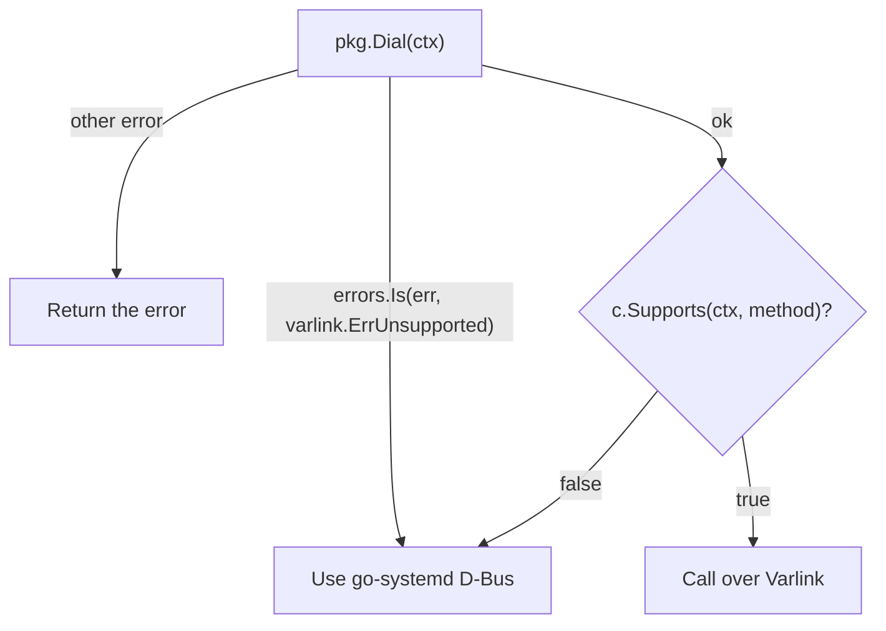

# Versioning & feature detection

systemd's Varlink API grows with every release: interfaces appear, methods are
added, fields become optional or change type. sdvarlink generates **one set of
bindings per systemd release**, so you can compile against exactly the API
your oldest supported host has, and detect anything newer at run time.

## Versioned packages

```text
systemd/
├── v257/   resolve/ hostname/ journal/ userdatabase/ mountfilesystem/ ...   (20 interfaces)
├── v258/   ... + manager/ unit/ login/ udev/ askpassword/ factoryreset/      (26 interfaces)
├── v260/   ... + metrics/ journalaccess/ repart/ networklink/ ...           (33 interfaces)
└── latest/ type aliases of the newest release (v260)
```

| Import | Pros | Cons |
| --- | --- | --- |
| `systemd/v257/resolve` (**pinned**) | Compiles against exactly what v257 hosts offer. Upgrading sdvarlink never changes these types. | Newer methods and fields aren't typed (they're still in `Extra`, or reachable via `Supports` + raw calls). |
| `systemd/latest/resolve` | Always the newest API, all methods typed. | A new sdvarlink release can change types under you when a newer systemd changes them. Calls to new methods fail on older hosts unless you feature-detect. |

!!! tip "Rule of thumb"

    **Libraries and daemons that run on many hosts:** import the package for the
    oldest systemd you support, and feature-detect newer methods.
    **Tools for a known fleet or a single host:** `latest` is fine.

Every package records where it came from:

<!-- check:import resolve257=github.com/rossedman/sdvarlink/systemd/v257/resolve -->
```go
fmt.Println(resolve257.SystemdVersion)   // 257
fmt.Println(resolve257.InterfaceName)    // io.systemd.Resolve
fmt.Println(resolve257.DefaultSocket)    // /run/systemd/resolve/io.systemd.Resolve
```

`latest` packages are **type aliases**, so their values are interchangeable
with the newest versioned package: a `latest/resolve.ResolveHostnameIn` *is* a
`v260/resolve.ResolveHostnameIn`.

## What changes between releases

The generated [API changes](../reference/api-changes.md) page lists every
added, removed and changed method, type and error between the releases sdvarlink
covers. Regenerate it locally with:

```sh
go run ./cmd/sdvarlink-gen diff 258 260
```

Three real examples show the kinds of changes to expect.

### A parameter is added

systemd v258 added an optional `offline` parameter to
`io.systemd.Journal.Synchronize`. The v257 binding takes no input; v258 and
later take a `SynchronizeIn`:

=== "v257"

    <!-- check:import journal=github.com/rossedman/sdvarlink/systemd/v257/journal -->
    ```go
    c, err := journal.Dial(ctx)
    if err != nil {
        return err
    }
    defer c.Close()
    return c.Synchronize(ctx)
    ```

=== "v258 and later"

    <!-- check:import journal=github.com/rossedman/sdvarlink/systemd/v258/journal -->
    ```go
    c, err := journal.Dial(ctx)
    if err != nil {
        return err
    }
    defer c.Close()
    return c.Synchronize(ctx, journal.SynchronizeIn{Offline: varlink.Ptr(true)})
    ```

A v258+ journald still accepts the v257 call (an absent optional parameter is
fine), which is why pinning to the oldest release is safe.

### Required fields become optional

In systemd v258, `io.systemd.Unit` reported every runtime state field. In v260
they became optional (`?string`, `?bool`), because a unit that isn't loaded
doesn't have them. The generated types follow:

=== "v258"

    <!-- check:import unit=github.com/rossedman/sdvarlink/systemd/v258/unit -->
    <!-- check: var c *unit.Client -->
    ```go
    // UnitRuntime.ActiveState string, .LoadState string, .CanStart bool
    for u, err := range c.ListMore(ctx, unit.ListIn{}) {
        if err != nil {
            return err
        }
        fmt.Println(u.Context.ID, u.Runtime.ActiveState, u.Runtime.CanStart)
    }
    ```

=== "v260 / latest"

    <!-- check: var c *unit.Client -->
    ```go
    // UnitRuntime.ActiveState *string, .LoadState *string, .CanStart *bool
    for u, err := range c.ListMore(ctx, unit.ListIn{}) {
        if err != nil {
            return err
        }
        fmt.Println(u.Context.ID, varlink.Deref(u.Runtime.ActiveState), varlink.Deref(u.Runtime.CanStart))
    }
    ```

What does that mean at run time?

- **v258 bindings talking to v260:** a missing or `null` field decodes as the
  zero value (`""`, `false`). You can't tell "absent" from "empty", but nothing
  fails.
- **v260 bindings talking to v258:** every field is present, so every pointer
  is non-nil. `varlink.Deref` reads them uniformly.

If you support both, write against the **newer** shape (pointers +
`varlink.Deref`) when it's available to you, or keep the older shape and treat
zero values as "unknown". Wrapping it in a tiny helper keeps call sites clean:

<!-- check:skip -->
```go
// state returns a unit's active state, or "unknown" when systemd didn't say.
func state(u *unit.ListOut) string {
    if s := varlink.Deref(u.Runtime.ActiveState); s != "" {
        return s
    }
    return "unknown"
}
```

### When a field changes type

systemd v258's IDL declared `io.systemd.Hostname.Describe`'s
`OperatingSystemImageID` and `OperatingSystemImageVersion` as `?int`; they are
strings (`IMAGE_ID=` from os-release), and v260 corrected the IDL to `?string`.
The generated bindings faithfully reflect each release:

| Package | `DescribeOut.OperatingSystemImageID` |
| --- | --- |
| `systemd/v258/hostname` | `*int64` |
| `systemd/v260/hostname` (and `latest`) | `*string` |

A type change is the one case where decoding can fail: if a host actually sets
`IMAGE_ID=`, the v258 binding gets a string where it expects a number and
returns a JSON decode error. When you hit one:

1. Prefer the release whose types match what hosts actually send (here,
   `v260/hostname` or `latest`). The extra fields of newer bindings are
   optional, so they decode older replies fine.
2. Or make a [raw call](raw-calls.md) and decode just the fields you need.

```go
// Decode only what you need, tolerant of type changes elsewhere.
var h struct {
    Hostname       string          `json:"Hostname"`
    ImageID        json.RawMessage `json:"OperatingSystemImageID"`
    KernelRelease  string          `json:"KernelRelease"`
}
c, err := hostname.Dial(ctx)
if err != nil {
    return err
}
defer c.Close()
if err := c.Caller().Call(ctx, "io.systemd.Hostname.Describe", nil, &h); err != nil {
    return err
}
fmt.Println(h.Hostname, string(h.ImageID), h.KernelRelease)
```

## Feature detection

A socket that exists doesn't mean every method exists. `systemd-resolved` has
served `io.systemd.Resolve` since before v257, but `BrowseServices` arrived in
v258 and `DumpDNSConfiguration` in v260. Ask the service with `Supports`,
which reads the live interface description, then call the method through the
package that types it:

<!-- check:import resolve=github.com/rossedman/sdvarlink/systemd/v257/resolve resolve260=github.com/rossedman/sdvarlink/systemd/v260/resolve -->
```go
c, err := resolve.Dial(ctx) // pinned to v257
if err != nil {
    return err // matches varlink.ErrUnsupported if resolved isn't running
}
defer c.Close()

ok, err := c.Supports(ctx, "DumpDNSConfiguration") // or "io.systemd.Resolve.DumpDNSConfiguration"
if err != nil {
    return err
}
if !ok {
    return errors.New("dumping DNS configuration needs systemd v260 or newer")
}

// Safe: this host has the method. Use the v260 types over the same pool.
cfg, err := resolve260.New(c.Caller()).DumpDNSConfiguration(ctx)
if err != nil {
    return err
}
for _, link := range cfg.Configuration {
    fmt.Printf("%-10s servers=%d dnssec=%s\n",
        varlink.Deref(link.Ifname), len(link.Servers), varlink.Deref(link.Dnssec))
}
```

!!! warning "Streaming annotations can change too"

    `io.systemd.Resolve.BrowseServices` was `Supports 'more'` in v258 (so the
    v258 package has `BrowseServices` *and* `BrowseServicesMore`) and became
    `Requires 'more'` in v260 (one iterator-returning `BrowseServices`). The
    [API changes](../reference/api-changes.md) page flags these as "streaming
    or nested type changed".

`Supports` returns `false, nil` when the method **or the whole interface** is
missing. Without a generated client, use the core function with any
`varlink.Caller`:

<!-- check: var conn *varlink.Conn -->
```go
ok, err := varlink.Supports(ctx, conn, "io.systemd.Resolve.DumpDNSConfiguration")
```

!!! note "Cost"

    Each `Supports` call fetches and parses the interface description: one
    round trip. Check once at startup and remember the answer; systemd doesn't
    gain methods without restarting the service.

### Probing many features

The [feature-detect example](../examples/feature-detect.md) builds a support
matrix for a host:

```text title="Output on a systemd v258 host (illustrative)"
FEATURE                          METHOD                STATUS
Describe the service manager     Describe              ✓ supported
List units over Varlink (v258+)  List                  ✓ supported
Change unit properties (v258+)   SetProperties         ✗ method missing on this systemd
Resolve host names               ResolveHostname       ✓ supported
Browse DNS-SD services           BrowseServices        ✓ supported
Dump DNS configuration           DumpDNSConfiguration  ✗ method missing on this systemd
Describe the host                Describe              ✓ supported
List machines                    List                  ✓ supported
```

## Mixing releases

Pin your baseline, and reach for a newer package only where you've confirmed
support. Clients from different releases can **share one connection pool**
through `Caller()`:

<!-- check:import unit258=github.com/rossedman/sdvarlink/systemd/v258/unit unit260=github.com/rossedman/sdvarlink/systemd/v260/unit -->
```go
base, err := unit258.Dial(ctx) // baseline: v258 types
if err != nil {
    return err
}
defer base.Close()

if ok, _ := base.Supports(ctx, "SetProperties"); ok {
    newer := unit260.New(base.Caller()) // same pool, v260 types
    err := newer.SetProperties(ctx, unit260.SetPropertiesIn{ /* ... */ })
    if err != nil {
        return err
    }
}
```

Fields a newer systemd sends that your pinned types don't know aren't lost:
they're in each struct's [`Extra`](typed-clients.md#unknown-fields-extra) map.

## Fallback to D-Bus

Below the v257 floor, or when a service isn't running, the socket is missing
and `Dial` fails with `varlink.ErrUnsupported`. Combine it with `Supports` for
a complete strategy:



See also [Errors: falling back](errors.md#falling-back-when-a-service-is-missing)
and [Migrating from go-systemd D-Bus](migrating-from-dbus.md).

## Which systemd is on the other end?

You rarely need the version (prefer `Supports`), but it's one call away:

```go
conn, err := varlink.Dial(ctx, "/run/systemd/io.systemd.Manager")
if err != nil {
    return err
}
defer conn.Close()

info, err := varlink.GetInfo(ctx, conn)
if err != nil {
    return err
}
fmt.Println(info.Product, info.Version) // "systemd (systemd)" "258 (258.1-1)"
```

## Compatibility promise

- The **core** (`varlink`, `idl`, `varlinktest`) and the **generator** follow
  semantic versioning.
- **Versioned packages** (`systemd/v257/...`) only gain files when sdvarlink
  adds a new systemd release; they change only to fix generator bugs.
- **`latest`** moves to the newest release when one is added.
- Interfaces systemd considers unstable can be generated under `x/` with no
  compatibility promise (none are, today).
