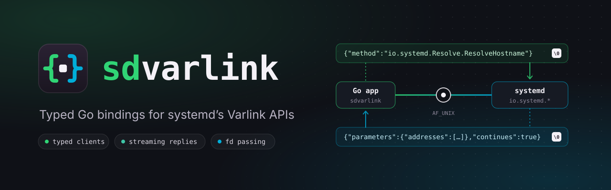
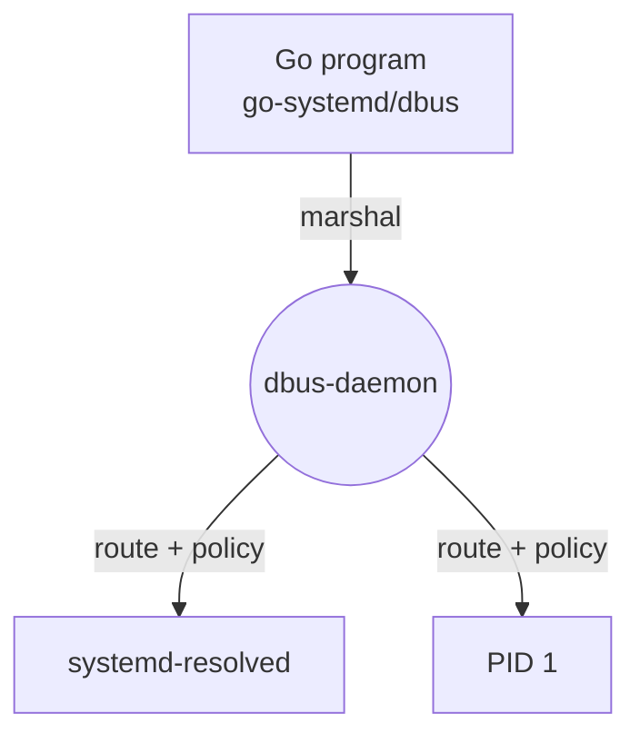
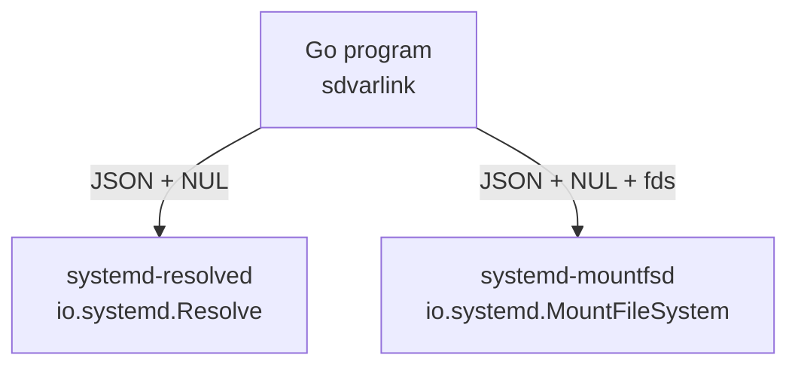

<div class="sd-hero" markdown>



<h1 class="sd-visually-hidden">sdvarlink</h1>

<div class="sd-hero__body" markdown>

<p class="sd-hero__lead">
<strong>Call systemd from Go with typed structs instead of hand-rolled JSON.</strong>
sdvarlink generates clients for every <code>io.systemd.*</code> Varlink interface, streams replies as Go iterators,
passes file descriptors in both directions and ships a fake server for your tests. Pure Go, no cgo.
</p>

<p class="sd-hero__actions">
<a class="md-button md-button--primary" href="getting-started/quickstart/">Get started</a>
<a class="md-button" href="https://github.com/rossedman/sdvarlink">View on GitHub</a>
</p>

<div class="sd-hero__install">go get github.com/rossedman/sdvarlink</div>

</div>
</div>

## Thirty seconds of sdvarlink { #thirty-seconds }

=== "Typed client"

    ```go
    package main

    import (
        "context"
        "fmt"
        "log"

        "github.com/rossedman/sdvarlink/systemd/latest/resolve"
    )

    func main() {
        ctx := context.Background()

        c, err := resolve.Dial(ctx) // (1)!
        if err != nil {
            log.Fatal(err)
        }
        defer c.Close()

        out, err := c.ResolveHostname(ctx, resolve.ResolveHostnameIn{Name: "systemd.io"})
        if err != nil {
            log.Fatal(err) // (2)!
        }
        for _, a := range out.Addresses {
            fmt.Println(out.Name, a.Family, a.Address)
        }
    }
    ```

    1.  Connects to `/run/systemd/resolve/io.systemd.Resolve`. If the socket does not
        exist, the error matches `varlink.ErrUnsupported`, so you can fall back to D-Bus.
    2.  Error replies are typed: `errors.Is(err, resolve.ErrNoSuchResourceRecord)` or
        `errors.As(err, &dnssecErr)` work as you'd expect.

=== "Streaming"

    ```go
    // GetUserRecordMore sets Varlink's "more" flag: systemd-userdbd streams
    // one reply per user, and the client yields them as an iter.Seq2.
    c, err := userdatabase.Dial(ctx)
    if err != nil {
        return err
    }
    defer c.Close()

    in := userdatabase.GetUserRecordIn{Service: "io.systemd.Multiplexer"}
    for rec, err := range c.GetUserRecordMore(ctx, in) {
        if err != nil {
            return err
        }
        fmt.Printf("%s\n", rec.Record) // break any time: the call is cleaned up
    }
    ```

=== "File descriptors"

    ```go
    img, err := os.Open("app.raw")
    if err != nil {
        return err
    }
    defer img.Close() // you keep ownership of files you send

    c, err := mountfilesystem.Dial(ctx)
    if err != nil {
        return err
    }
    defer c.Close()

    // The *os.File travels as SCM_RIGHTS ancillary data; the JSON carries its index.
    out, err := c.MountImage(ctx, mountfilesystem.MountImageIn{
        ImageFileDescriptor: img,
        ReadOnly:            varlink.Ptr(true),
    })
    if err != nil {
        return err
    }
    for _, p := range out.Partitions {
        fmt.Println(p.Designator, p.FileSystemType)
        p.MountFileDescriptor.Close() // files you receive are yours to close
    }
    ```

=== "Testing"

    ```go
    func TestLookup(t *testing.T) {
        srv := varlinktest.NewServer(t) // temp socket, closed with the test
        varlinktest.On(srv, "io.systemd.Resolve.ResolveHostname",
            func(ctx context.Context, in resolve.ResolveHostnameIn) (resolve.ResolveHostnameOut, error) {
                if in.Name != "example.com" {
                    return resolve.ResolveHostnameOut{}, &resolve.NoSuchResourceRecordError{}
                }
                return resolve.ResolveHostnameOut{
                    Name:      in.Name,
                    Addresses: []resolve.ResolvedAddress{{Family: 2, Address: []int64{93, 184, 215, 14}}},
                }, nil
            })

        c, err := resolve.DialPath(context.Background(), srv.Path())
        if err != nil {
            t.Fatal(err)
        }
        defer c.Close()

        _, err = c.ResolveHostname(context.Background(), resolve.ResolveHostnameIn{Name: "nope.invalid"})
        if !errors.Is(err, resolve.ErrNoSuchResourceRecord) {
            t.Fatalf("err = %v", err)
        }
    }
    ```

<div class="sd-stats" markdown>
<div class="sd-stat"><b>33</b><span>interfaces in systemd v260</span></div>
<div class="sd-stat"><b>102</b><span>typed methods, generated</span></div>
<div class="sd-stat"><b>3</b><span>pinned releases: v257 · v258 · v260</span></div>
<div class="sd-stat"><b>0</b><span>cgo, brokers or daemons</span></div>
<div class="sd-stat"><b>1</b><span>dependency: golang.org/x/sys</span></div>
</div>

## What you get { #features }

<div class="grid cards" markdown>

-   :material-language-go:{ .lg .middle } **Typed, generated clients**

    ---

    One package per interface, generated from systemd's own IDL: input and
    output structs, enums with constants, doc comments carried over.

    [:octicons-arrow-right-24: Typed clients](guides/typed-clients.md)

-   :material-waves:{ .lg .middle } **Streaming as iterators**

    ---

    Methods that answer with many replies return `iter.Seq2[*Out, error]`.
    Range over them; `break` and context cancellation clean up for you.

    [:octicons-arrow-right-24: Streaming](guides/streaming.md)

-   :material-file-swap:{ .lg .middle } **File-descriptor passing**

    ---

    `*os.File` fields travel via `SCM_RIGHTS` in both directions, attached to
    the exact message that references them. Leak-tested.

    [:octicons-arrow-right-24: File descriptors](guides/file-descriptors.md)

-   :material-alert-octagon-outline:{ .lg .middle } **Typed errors**

    ---

    Every IDL error becomes a Go type plus an `Err<Name>` sentinel.
    `io.systemd.System` unwraps to `syscall.Errno`.

    [:octicons-arrow-right-24: Errors](guides/errors.md)

-   :material-source-branch:{ .lg .middle } **Versioned per systemd release**

    ---

    Import `systemd/v257/...` to pin the oldest systemd you support, or
    `systemd/latest/...` to follow upstream. Feature-detect with `Supports`.

    [:octicons-arrow-right-24: Versioning](guides/versioning.md)

-   :material-test-tube:{ .lg .middle } **A fake server for tests**

    ---

    `varlinktest` serves typed handlers on a temp socket, records calls, and
    records/replays sessions against real systemd as golden files.

    [:octicons-arrow-right-24: Testing](guides/testing.md)

-   :material-lan-connect:{ .lg .middle } **Pooled & concurrent**

    ---

    Generated clients wrap a connection pool, so goroutines never queue
    behind each other on one socket. Contexts set deadlines.

    [:octicons-arrow-right-24: Concurrency](guides/concurrency.md)

-   :material-console:{ .lg .middle } **Raw calls when you need them**

    ---

    The `varlink` core calls any method with `json.RawMessage`, introspects
    services and parses IDL. Like `varlinkctl`, in Go.

    [:octicons-arrow-right-24: Raw calls](guides/raw-calls.md)

</div>

## Why Varlink? { #why-varlink }

D-Bus routes every call through a broker daemon. Varlink is a direct
conversation: NUL-terminated JSON over a Unix socket the service owns. No
broker means it works in early boot, in the initrd and in minimal containers,
where `dbus-daemon` isn't running, and it adds streaming replies and
file-descriptor passing.

<div class="sd-compare" markdown>
<div markdown>

#### :material-bus: D-Bus: brokered



</div>
<div markdown>

#### :material-lan-connect: Varlink: direct



</div>
</div>

systemd v257 shipped 19 Varlink interfaces, against 11 D-Bus services, and
newer subsystems such as userdb, metrics, mountfsd and machine image
management speak Varlink first, or only. Learn the protocol in
[Core concepts](getting-started/concepts.md), or jump into the
[examples](examples/index.md).

<div class="grid cards" markdown>

-   :material-rocket-launch-outline:{ .lg .middle } **New here?**

    ---

    Install, then write and run your first program in five minutes.

    [:octicons-arrow-right-24: Quickstart](getting-started/quickstart.md)

-   :material-swap-horizontal:{ .lg .middle } **Coming from go-systemd?**

    ---

    Side-by-side D-Bus vs Varlink code, and when to keep D-Bus.

    [:octicons-arrow-right-24: Migration guide](guides/migrating-from-dbus.md)

-   :material-book-open-variant:{ .lg .middle } **Looking something up?**

    ---

    Every interface, method, type and error, with the release that added it.

    [:octicons-arrow-right-24: Interface reference](reference/interfaces.md)

</div>
