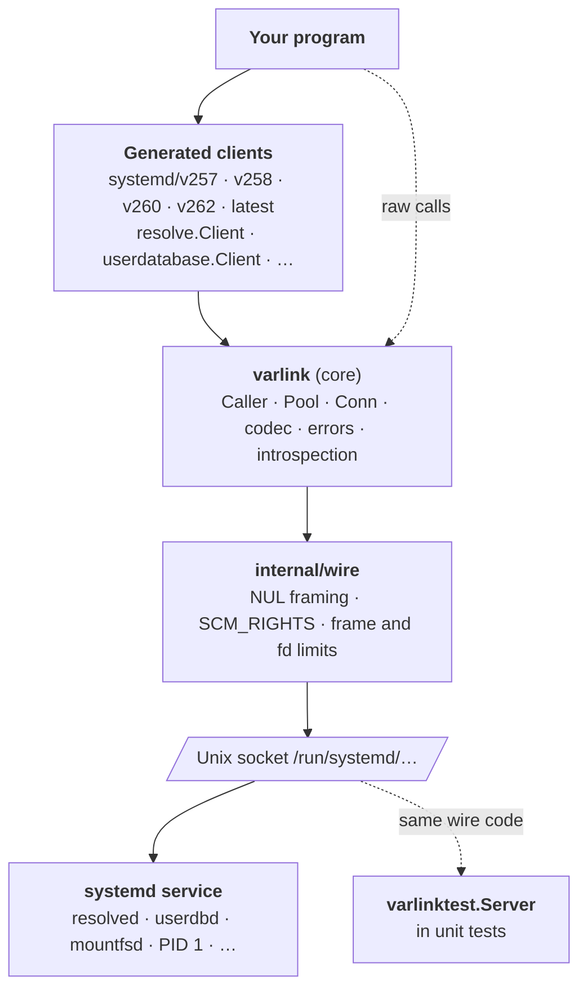
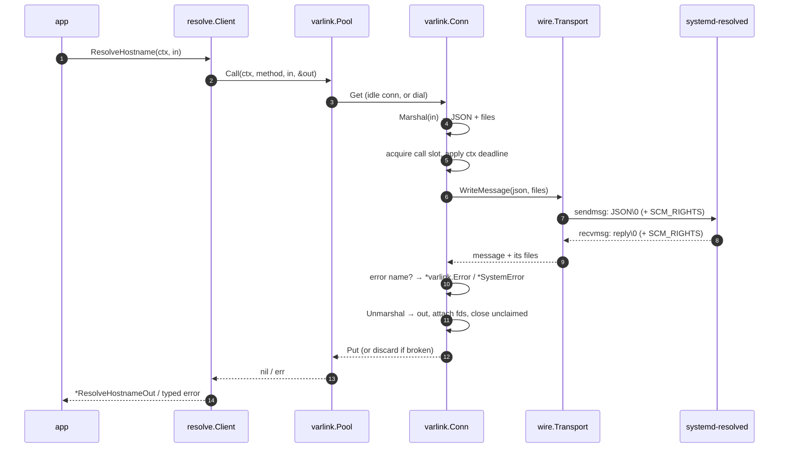
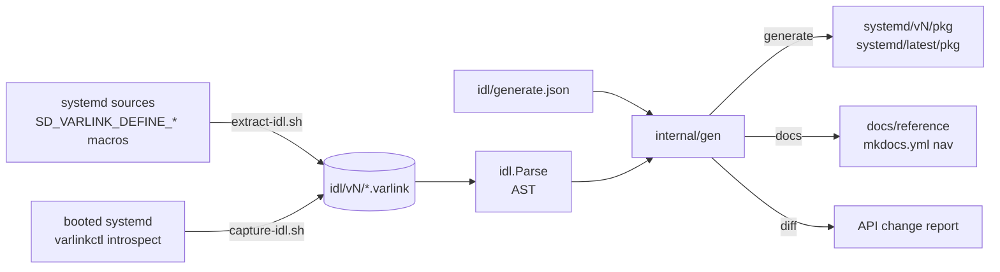

# Architecture

sdvarlink has three parts: a **small runtime core**, **packages generated**
from systemd's IDL, and a **fake server** for tests. Only the transport touches
the socket, so the fake can replace systemd without changing any code above
it. The generator runs at build time, not at run time: the module you import
is plain Go that needs only the standard library and `golang.org/x/sys`.

## Runtime layers

| Layer | Package | Responsibilities |
| --- | --- | --- |
| Generated clients | `systemd/v<N>/<pkg>`, `systemd/latest/<pkg>` | Typed structs, enums and errors; one method per IDL method; streaming variants; `Dial`/`DialPath`/`New`; `Supports`; error conversion to typed errors. |
| Core | `varlink` | `Conn` (serializes calls, applies contexts, closes on abandoned calls), `Pool`, raw `Call`/`Stream`/`Oneway`, the fd-aware codec, error types, introspection. |
| Transport | `internal/wire` | Reads and writes NUL-terminated frames; sends descriptors with `SCM_RIGHTS` on the message's first byte; assigns received descriptors to the last message that begins in the read that carried them; enforces frame and fd limits. Shared with `varlinktest`. |
| Testing | `varlinktest` | A server on a temp socket using the same transport: typed and raw handlers, introspection, call log, record/replay. |
| Tooling | `idl`, `internal/gen`, `cmd/sdvarlink-gen` | IDL parser, Go/doc/diff generator. `idl` is also used at run time by `Supports`. |

### A call, end to end

## Code generation pipeline

1. **Capture.** IDL snapshots for each systemd release land in `idl/v<N>/`,
   either extracted from the release's source with the C preprocessor (no
   boot needed) or captured from a running system.
2. **Parse.** `idl.Parse` builds an AST, including doc comments and systemd's
   `more` annotations.
3. **Emit.** `internal/gen` writes one package per interface per release: in/out
   structs with `Extra` and an `UnmarshalJSON`, enums with constants, error types
   with sentinels, the client, and the embedded IDL. `systemd/latest` re-exports
   the newest release with type aliases. Output is `gofmt`ed.
4. **Diff.** A report of added, removed and changed methods, types and errors
   between releases, published as [API changes](../reference/api-changes.md).

CI checks the pipeline end to end: generated code must match the committed
code (`make check-generated`), golden files pin the generator's output, and a
weekly drift job re-extracts the newest systemd's IDL and opens a pull request
when it changes.

## Testing layers

| Layer | What | When |
| --- | --- | --- |
| Unit | Codec, framing, fd bookkeeping (incl. leak counts), errors, pools, generator golden files, `varlinktest` | Every PR, any OS |
| Fuzz | Frame reader, codec, IDL parser (`make fuzz`) | Nightly |
| Integration | Generated clients against live systemd sockets, read-only methods; `varlinkctl` against the fake (`-tags integration`) | Every PR, per supported systemd release |
| Drift | Re-extract IDL from the newest systemd and diff against snapshots | Weekly; opens a PR on change |

Mutating integration tests run only in disposable VMs
(`SDVARLINK_MUTATING=1`).

## Design choices

- **Purpose-built core, not a general Varlink library.** File-descriptor
  passing had to be first-class: descriptors attached to the exact message
  that references them, with ownership rules and leak tests. Existing Go
  Varlink libraries don't support that.
- **Iterators for streams.** `iter.Seq2` makes `more` calls a `range` loop, with
  `break` and context cancellation doing the cleanup.
- **Versioned packages, not runtime negotiation.** Types are fixed at compile
  time per release; `Supports` handles what varies at run time.
- **Unknown fields are kept** (`Extra`) so older bindings stay forward
  compatible without silently losing data.
- **No logging, no global state, no cgo.**

More background in the [Design](design.md) document.
