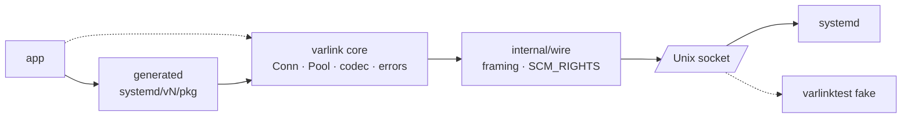
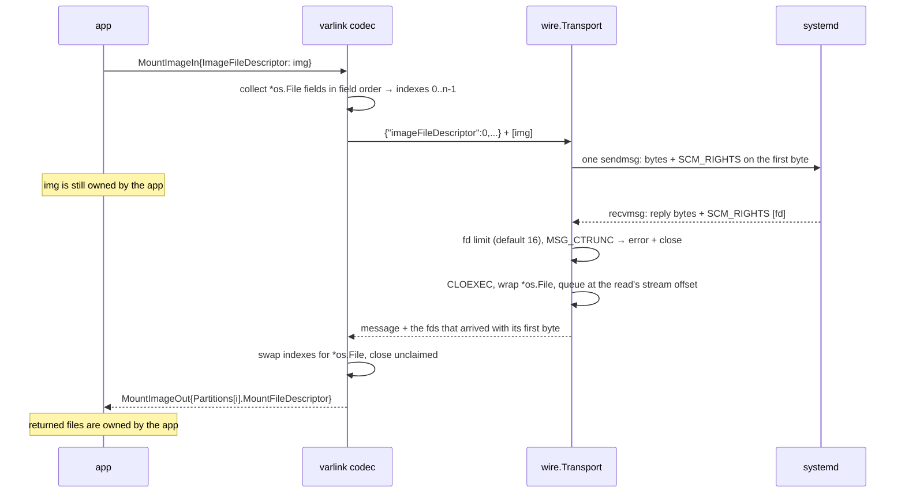

# Design

This is the design document sdvarlink was built from, lightly edited. Where
the implementation ended up different from, or more specific than, the plan,
a note says so.

## Summary

sdvarlink is a Go module that provides typed, generated, tested clients for
systemd's `io.systemd.*` Varlink interfaces. It does for Varlink what
[coreos/go-systemd](https://github.com/coreos/go-systemd) does for D-Bus.

**Varlink in one paragraph.** Varlink is an IPC protocol: JSON objects, each
ending in a NUL byte, over a Unix socket. A service publishes its API in a
small interface definition language (IDL) and answers introspection calls
(`org.varlink.service.GetInfo`, `GetInterfaceDescription`). A call names a
method and passes parameters; the reply carries parameters or a qualified
error name. A client can ask for a stream of replies (`more`) or no reply
(`oneway`).

**Why systemd moved.** Varlink needs no broker, so it works in early boot, the
initrd and containers where `dbus-daemon` is absent. It supports streaming
replies and file-descriptor passing, and it is easy to debug with
`varlinkctl`. systemd v257 shipped 19 Varlink interfaces against 11 D-Bus
services, and newer subsystems (userdb, metrics/report, mstack, machine and
image management) expose Varlink first or only.

**The gap.** coreos/go-systemd speaks D-Bus and native protocols only. The Go
Varlink libraries are protocol layers with no curated systemd bindings, and
none clearly support fd passing. Go daemons that want new systemd features
today hand-roll JSON over sockets or shell out to `varlinkctl`.

## Goals and non-goals

v1.0 succeeds when a Go program can call any stable `io.systemd.*` method with
typed structs, stream replies, pass file descriptors and unit-test against a
fake, with zero cgo.

**Goals**

1. Typed Go clients for systemd's stable Varlink interfaces, generated from
   systemd's own IDL.
2. A small, dependency-light core: wire protocol, connection, call, stream,
   error mapping.
3. Streaming replies as Go iterators (`iter.Seq2[T, error]`) with
   `context.Context` cancellation.
4. File-descriptor passing in both directions via `SCM_RIGHTS`.
5. Bindings versioned per systemd release, so callers can target the oldest
   systemd they support.
6. A `varlinktest` fake server that replays canned or scripted replies for unit
   tests.
7. Pure Go, no cgo, static binaries, Linux only.

**Non-goals**

- Replacing go-systemd's D-Bus packages. sdvarlink can sit beside them.
- Wrapping every systemd tool. The scope is the Varlink API surface, not
  `systemctl` semantics.
- A Varlink resolver or the `org.varlink.resolver` service. systemd uses fixed
  socket paths.
- TCP, TLS or remote transports in v1. Unix sockets cover systemd; remote
  access is varlink-http-bridge's job.
- A server-side framework for arbitrary services beyond the fake and a minimal
  metrics provider (see [Roadmap](roadmap.md)).

## Architecture

Three parts: a small runtime core, packages generated from systemd's IDL, and
a fake server for tests. Only the transport touches the socket, so the fake
can replace systemd without changing any code above it. The generator runs at
build time, not at run time: the shipped module contains plain Go code and
needs nothing but the standard library and `x/sys/unix`.

See [Architecture](architecture.md) for the detailed diagrams.

## Public API

Callers use generated packages for systemd interfaces and drop to the core
`varlink` package only for custom or unstable methods. Errors map to typed Go
errors per interface (`errors.As`); unknown names become `*varlink.Error`.
Streaming methods return an iterator; breaking out or cancelling `ctx` closes
the call. Methods with fds take and return `*os.File`; inputs are borrowed for
the call, outputs belong to the caller. Concurrency: a `Conn` handles one call
at a time; a `Pool` hands out connections; generated clients wrap a `Pool`.

!!! note "As built"

    - Every generated error type also gets an **`Err<Name>` sentinel**
      (a `*varlink.Error` with that name), so `errors.Is(err, resolve.ErrNoSuchResourceRecord)`
      works alongside `errors.As`. Sentinels match by name, so they also match
      untyped errors from raw calls.
    - `io.systemd.System` errors become `*varlink.SystemError`, which unwraps to
      `syscall.Errno`.
    - `Supports-more` methods get **two** methods, `X` (one reply) and `XMore`
      (an `iter.Seq2`); `Requires-more` methods get only the iterator `X`.
    - Breaking out of a stream closes the **connection**, since Varlink can't
      cancel a call; pools discard it and dial a fresh one.

## Code generation and versioning

**Pipeline.**

1. **Capture:** CI boots each systemd version and runs `varlinkctl introspect`
   on every socket under `/run/systemd/`, `/run/systemd/userdb/` and
   `/run/systemd/report/` → `idl/v<N>/<interface>.varlink`.
2. **Parse:** `sdvarlink-gen` parses IDL into an AST.
3. **Emit:** a Go package per interface: in/out structs, enum types with
   `String()`, error types, a client with one method per call, doc comments
   from the IDL.
4. **Diff:** a report of added/removed/changed methods between releases,
   published with each release.

!!! note "As built"

    Snapshots can also be **extracted from systemd's source** without booting
    it: `hack/extract-idl.sh` runs systemd's `SD_VARLINK_DEFINE_*` macros
    through the C preprocessor (`hack/idl-from-source/`). The committed
    snapshots for v257, v258 and v260 came from this path; `hack/capture-idl.sh`
    implements the boot-and-introspect path.

**Type mapping.**

| IDL | Go |
| --- | --- |
| `bool` / `int` / `float` / `string` | `bool` / `int64` / `float64` / `string` |
| `?T` | `*T` + `omitempty` |
| `[]T` | `[]T` |
| `[string]T` | `map[string]T` |
| `object` | `json.RawMessage` |
| enum | named string + constants |
| inline struct | named struct `<Parent><Field>` |
| fd index field | `*os.File`, resolved by the transport |

!!! note "As built"

    - fd fields are recognized by name (an `int` field ending in
      `FileDescriptor`) and generated as `*os.File` with the tag
      `` `json:"-" varlink:"<name>,fd"` ``. The codec, not the transport, swaps
      indexes for files; the transport assigns descriptors to messages.
    - Every struct has `Extra map[string]json.RawMessage` for fields the
      bindings don't know.
    - Inline types are named `<Parent><Field>` (the spec draft said
      `<Method><Field>`).
    - The Go keyword package `import` is generated as `importd`.
    - The full rules are in [Type mapping & naming](../reference/type-mapping.md).

**Layout.** `systemd/v257/…`, `v258`, `v260` are separate packages; import the
oldest you support. `systemd/latest` re-exports the newest. Each client exposes
`Supports(ctx, "Method")` via live introspection. Unstable interfaces are
generated under `x/` with no compatibility promise. Semver applies to the core
and generator; generated version directories only gain files for new releases,
and change only to fix generator bugs.

## File descriptor passing

File descriptors are attached to the exact message that references them, via
`SCM_RIGHTS` on the same `sendmsg`; the JSON carries each fd as an integer
index into that message's fd array (matching `sd-varlink`).

- **Send:** collect `*os.File` fields in field order, assign indexes `0..n-1`,
  encode the JSON with the indexes, and call `WriteMsgUnix` with `UnixRights` as
  OOB in the same call. The caller keeps ownership.
- **Receive:** `ReadMsgUnix` with an OOB buffer sized for a configurable fd
  limit (default 16); parse `SCM_RIGHTS`, wrap in `*os.File`, queue against the
  message. The decoder swaps indexes for files; the caller owns returned files;
  unclaimed fds are closed.
- **Edge cases:** `MSG_CTRUNC` → error, and close what arrived. fds on a read
  spanning two messages are assigned per kernel semantics (to the last
  message that begins within the read). Close-on-exec is set explicitly. Servers
  refusing fd input surface a typed error.

**Why it matters.** Image mounting and some machine/mount operations take fds;
no Go Varlink library was confirmed to support this. It's sdvarlink's main
differentiator.

See the [File descriptors guide](../guides/file-descriptors.md).

## Testing

The `varlinktest` fake server (temporary Unix socket, closed on `t.Cleanup`):
typed handlers plus a raw JSON handler; streaming handlers; fd fixtures;
record/replay to golden files; serves captured IDL for introspection so
`Supports()` works.

!!! note "As built"

    The fake is the package `varlinktest`. Typed handlers come in two forms:
    **reflection** (`Server.Handle(method, fn)`, accepting
    `func(In) (Out, error)`, `func(ctx, In) (Out, error)` or
    `func(ctx, In) iter.Seq2[Out, error]`) and **generics**
    (`varlinktest.On` / `OnStream`, checked at compile time). Raw handlers use
    `HandleRaw`. Generated packages embed their IDL as `InterfaceDescription`
    for `AddInterface`. See [Testing](../guides/testing.md).

| Layer | What | When |
| --- | --- | --- |
| Unit | codec, framing, fd bookkeeping, generator golden files | every PR, any OS |
| Fuzz | `go test -fuzz` on the frame reader and JSON decoder | nightly |
| Integration | generated clients against live systemd sockets | every PR, per supported systemd version in a VM or `systemd-nspawn` container |
| Drift | regenerate IDL from the newest systemd and diff against committed snapshots | weekly; opens a PR on change |

Integration tests run read-only methods by default; mutating methods run only
in disposable VMs.

## Compatibility, security and performance

**Compatibility.** The two newest Go releases (Go 1.26+ today). systemd v257
floor: older hosts get `ErrUnsupported` from `Dial` and fall back to go-systemd
D-Bus. Linux only, amd64 and arm64 tested; other OSes compile the core and the
fake for tests, but `Dial` returns `ErrUnsupported`. Dependencies: stdlib +
`golang.org/x/sys/unix` (the generator may use more; the runtime may not).

**Security.** Authorization stays with systemd (`SO_PEERCRED`, polkit);
sdvarlink adds no privilege. Frame size limit (16 MiB default) and fd count
limit. Strict decoding, with unknown fields kept in `Extra`. Received fds are
closed on every error path (tests count open fds). No logging of parameters
by default. See the [Security model](../guides/security.md).

**Performance.** Reuse connections via `Pool`; `encoding/json` in v1;
benchmarks in CI for round-trip and stream throughput against the fake;
targets set after the first baseline.

## Roadmap

See [Roadmap](roadmap.md) for milestones and gates.

## Open questions

| Question | Status |
| --- | --- |
| Use `emersion/go-varlink` as the core, or purpose-built? | **Decided: purpose-built**, for the fd requirements. |
| Which interfaces are formally stable vs experimental? | Open. `idl/generate.json` can mark interfaces unstable (generated under `x/`); none are marked today. |
| Does any systemd method send fds back? | **Yes**, found in the IDL: `io.systemd.MountFileSystem.MountImage` returns mount fds, `io.systemd.Machine.Open` returns a PTY fd, `io.systemd.NamespaceResource` returns tap fds. |
| Exact fd-index convention per method? | Indexes into the message's fd array, in field order, as `sd-varlink` does. |
| Module path, license, org home? | `github.com/rossedman/sdvarlink`, MIT. |
