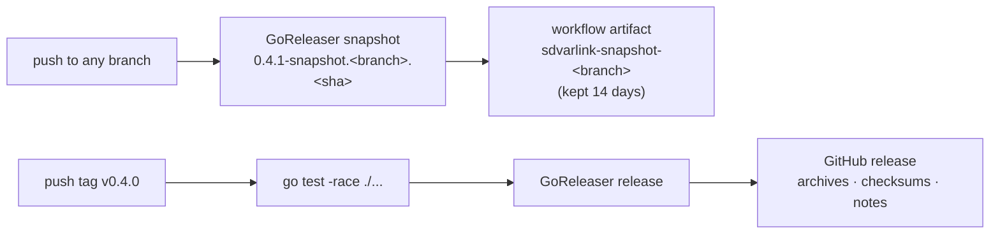

# Releases

sdvarlink is a Go module: you get the library with `go get`, at a tag or a
commit. Each release also ships **`sdvarlink-gen`**, the code generator, as
prebuilt binaries built by [GoReleaser](https://goreleaser.com).

```sh
go get github.com/rossedman/sdvarlink@latest   # the library
go install github.com/rossedman/sdvarlink/cmd/sdvarlink-gen@latest   # or build the generator yourself
```

## What gets versioned how

| Part | Versioning |
| --- | --- |
| `varlink`, `idl`, `varlinktest`, `sdvarlink-gen` | [Semantic versioning](https://semver.org/). Before v1.0, minor releases may change APIs; the changelog says how. |
| `systemd/v<N>/…` | Follows systemd's IDL for release N exactly. A new systemd release adds a directory; existing directories change only to fix generator bugs. |
| `systemd/latest/…` | Re-exports the newest `v<N>`; moves when a release adds one. |

## Release flow



### Snapshots on every branch

Every push to any branch builds a snapshot with the same configuration as a
real release. Snapshots are not published as GitHub releases; download them
from the workflow run:

1. Open **Actions → Release** and pick the run for your branch.
2. Download the **`sdvarlink-snapshot-<branch>`** artifact. It contains one
   archive per platform plus `checksums.txt`. The run summary lists the
   checksums.

Snapshot versions name their branch and commit, for example
`0.4.1-snapshot.feature-unit-api.a1b2c3d`, and `sdvarlink-gen version`
prints it.

### Tagged releases

Pushing a `v*` tag runs the full test suite with the race detector, then
publishes a GitHub release with:

- `sdvarlink-gen` for Linux, macOS and FreeBSD on amd64 and arm64;
- the IDL snapshots and `generate.json` in every archive, so the binary
  works on its own;
- `checksums.txt` (SHA-256);
- release notes grouped by commit prefix: `idl:` (new systemd releases),
  `feat:`, `fix:`.

Tags with a pre-release suffix, such as `v0.4.0-rc.1`, are marked as
pre-releases.

## Using a release binary

```sh
tar xzf sdvarlink-gen_0.4.0_linux_amd64.tar.gz
./sdvarlink-gen version
./sdvarlink-gen generate -idl idl -config idl/generate.json -out systemd
./sdvarlink-gen diff 258 260 > api-changes.md
```

Verify downloads against `checksums.txt`:

```sh
sha256sum --check --ignore-missing checksums.txt
```

## Cutting a release (maintainers)

```sh
make release-check                      # validate .goreleaser.yaml
make snapshot                           # build dist/ locally, exactly as CI does
git tag -a v0.4.0 -m "v0.4.0"
git push origin v0.4.0                  # CI publishes the release
```

Update `CHANGELOG.md` before tagging. See
[Contributing](contributing.md) for the rest of the workflow.
