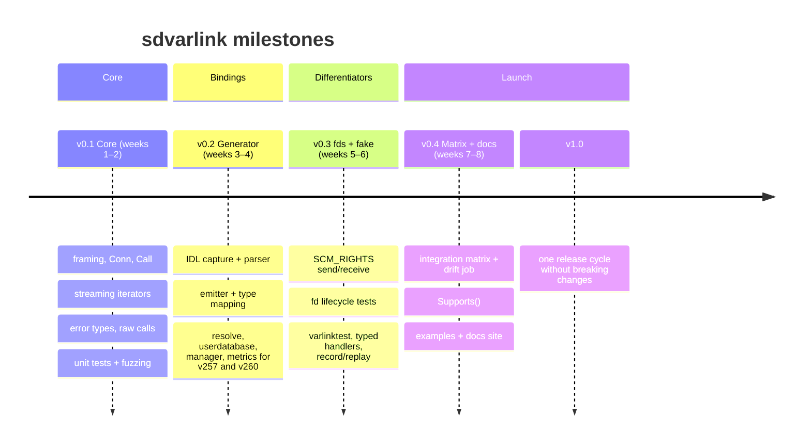

# Roadmap

Roughly eight weeks of part-time work, in four milestones. Each milestone is a
tagged release with a **gate**: a concrete check that must pass before the tag.

## Milestones and gates

| Milestone | Scope | Gate |
| --- | --- | --- |
| **v0.1 Core** | Framing, `Conn`, `Call`, streaming iterators, error type, raw calls, unit tests and fuzzing. | Raw calls to `io.systemd.Manager` and `io.systemd.Resolve` work on a v260 host. |
| **v0.2 Generator** | IDL capture job, parser, emitter, type mapping; generated `resolve`, `userdatabase`, `manager`, `metrics` for v257 and v260. | Generated code compiles for every captured interface and passes golden-file tests. |
| **v0.3 fds and fake** | `SCM_RIGHTS` send/receive, fd lifecycle tests, `varlinktest` with typed handlers and record/replay. | An fd-taking method round-trips against real systemd, and open-fd counts stay flat across 10,000 calls. |
| **v0.4 Matrix and docs** | Integration matrix, drift job, `Supports()`, examples, pkg.go.dev docs, this site. | Green matrix on v257, v258 and v260; a first external user (tether or report2otel) builds on it. |
| **v1.0** | API freeze. | The API has gone a release cycle without breaking changes. |

### Gate checklist

- [x] Generated code compiles for every captured interface (v257, v258, v260: 79 packages).
- [x] Generator output pinned by golden-file tests.
- [x] fd round trip and leak tests against the fake (thousands of calls, flat fd count).
- [x] Integration tests against a real `systemd-journald`, and `varlinkctl` as a client of the fake.
- [x] `Supports()` on every generated client; 15 runnable examples; documentation site.
- [ ] fd-taking method round-tripped against real systemd (`mountfsd`) in CI.
- [ ] Green integration matrix on v257, v258 and v260 VMs.
- [ ] First external user builds on it.

## Follow-on work

-   :material-check-circle-outline:{ .lg .middle } **Varlink server** (done)

    ---

    `varlink.Server` serves interfaces from Go: typed handlers, live and list
    streams, peer credentials, socket activation and graceful shutdown. Go
    daemons can now **publish** `io.systemd.Metrics` under
    `/run/systemd/report/`, the base for report2otel. See
    [Serving Varlink](../guides/server.md).

-   :material-swap-horizontal-bold:{ .lg .middle } **tether backend**

    ---

    A tether backend that swaps D-Bus calls for sdvarlink wherever Varlink is
    available, falling back to D-Bus elsewhere.

## Out of scope

These are deliberate [non-goals](design.md#goals-and-non-goals): replacing
go-systemd's D-Bus packages, wrapping `systemctl` semantics,
`org.varlink.resolver`, and TCP/TLS or remote transports. The server serves
Unix sockets only, and has no `upgrade` support yet.

Have a use case that doesn't fit? [Open an issue](https://github.com/rossedman/sdvarlink/issues/new/choose).
