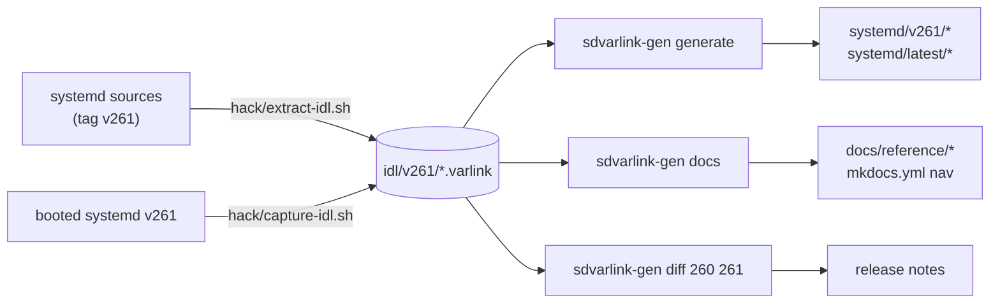

# sdvarlink-gen

`sdvarlink-gen` turns IDL snapshots into Go packages, this site's interface
reference, and release-to-release API reports. **You don't need it to use
sdvarlink**: the generated packages are checked in. It's for contributors
adding a systemd release, and for anyone generating bindings for their own
Varlink interfaces.

```sh
go run ./cmd/sdvarlink-gen <command> [flags]
# or
go install github.com/rossedman/sdvarlink/cmd/sdvarlink-gen@latest
```

Prebuilt binaries for Linux, macOS and FreeBSD (amd64, arm64) are attached to
each [GitHub release](https://github.com/rossedman/sdvarlink/releases), bundled
with the IDL snapshots.

```text
usage:
  sdvarlink-gen generate [-idl dir] [-out dir] [-config file]
  sdvarlink-gen diff [-idl dir] OLD NEW
  sdvarlink-gen docs [-idl dir] [-out dir] [-config file]
  sdvarlink-gen version
```

## Inputs

```text
idl/
├── generate.json          # generator config
├── v257/
│   ├── io.systemd.Hostname.varlink
│   ├── io.systemd.Resolve.varlink
│   └── ...
├── v258/
└── v260/
```

Each `idl/v<N>/` directory holds one `.varlink` file per interface, exactly as
`varlinkctl introspect` prints it (doc comments and `[Requires 'more' flag]`
annotations included).

`idl/generate.json`:

```json
{
  "module": "github.com/rossedman/sdvarlink",
  "fdFieldSuffix": "FileDescriptor",
  "unstable": [],
  "sockets": {
    "io.systemd.Resolve": "/run/systemd/resolve/io.systemd.Resolve",
    "io.systemd.Unit": "/run/systemd/io.systemd.Manager"
  }
}
```

| Key | Meaning |
| --- | --- |
| `module` | Go module path of the generated packages. |
| `fdFieldSuffix` | `int` fields whose names end with this carry file descriptors (default `FileDescriptor`). |
| `unstable` | Interfaces generated under `systemd/v<N>/x/` with no compatibility promise. |
| `sockets` | Default socket per interface: becomes `DefaultSocket` and enables `Dial`. |

## `generate`

Generate one Go package per interface per release, plus `systemd/latest`.

| Flag | Default | Meaning |
| --- | --- | --- |
| `-idl` | `idl` | Directory of `v<N>` snapshot directories. |
| `-out` | `systemd` | Output directory. `v*/` and `latest/` under it are **rewritten from scratch**. |
| `-config` | `idl/generate.json` | Generator config. |

```sh
$ go run ./cmd/sdvarlink-gen generate
generated 79 packages for 3 systemd releases (latest = v260)
```

Output per interface: `systemd/v<N>/<pkg>/<pkg>.go` and a copy of the IDL,
embedded as `InterfaceDescription`. For the newest release,
`systemd/latest/<pkg>/<pkg>.go` re-exports every type, constant, variable and
function as aliases. Same as `make generate`.

## `diff`

Print the API changes between two releases as Markdown: added, removed and
changed interfaces, methods, types and errors.

| Argument / flag | Meaning |
| --- | --- |
| `OLD NEW` | Release numbers, with or without `v` (`257 260`, `v257 v260`). |
| `-idl` | Snapshot directory (default `idl`). |

```sh
$ go run ./cmd/sdvarlink-gen diff 257 258 | head -8
## systemd v257 → v258

38 added · 17 changed · 1 removed

| Interface | Kind | Name | Change | Detail |
| --- | --- | --- | --- | --- |
| `io.systemd` | error | `System` | :material-pencil-circle:{ .changed } changed | + errno: ?int, errnoName: ?string, origin: ?string; − errno: int |
| `io.systemd.AskPassword` | interface | `io.systemd.AskPassword` | :material-plus-circle:{ .added } added | 1 methods |
```

The output uses this site's icon and attribute syntax, and renders as the
[API changes](api-changes.md) page. Same as `make api-diff FROM=257 TO=258`.

## `docs`

Write the interface reference: an overview (`interfaces.md`), one page per
interface in the newest release (`interfaces/<pkg>.md`) and `api-changes.md`.
It also rewrites the navigation block in `mkdocs.yml`.

| Flag | Default | Meaning |
| --- | --- | --- |
| `-idl` | `idl` | Snapshot directory. |
| `-out` | `docs/reference` | Output directory. `interfaces/` under it is rewritten. |
| `-config` | `idl/generate.json` | Generator config (for default sockets). |
| `-mkdocs` | `mkdocs.yml` | File whose generated nav block to update; empty to skip. |

The nav block sits between two marker comments in `mkdocs.yml`; everything in
between is replaced, with entries indented by 10 spaces:

```yaml
      - Interfaces:
          - reference/interfaces.md
          # BEGIN generated interface nav
          - io.systemd.Resolve: reference/interfaces/resolve.md
          # END generated interface nav
```

```sh
$ go run ./cmd/sdvarlink-gen docs
wrote 35 reference pages
```

Same as `make docs-reference`.

## `version`

```sh
$ sdvarlink-gen version
sdvarlink-gen v0.4.0 (commit 1a2b3c4, built 2026-10-16T00:00:00Z)
```

## Getting IDL snapshots

Two scripts produce `idl/v<N>/` in the same format:

=== "From source (no boot needed)"

    ```sh
    make idl SYSTEMD_VERSION=261     # runs hack/extract-idl.sh 261
    ```

    Sparse-clones systemd at tag `v261` and runs
    `hack/idl-from-source/extract.py`, which expands systemd's
    `SD_VARLINK_DEFINE_*` C macros with the C preprocessor into the IDL text
    `varlinkctl introspect` would print. Needs `git`, `cpp` and `python3`.

=== "From a running system"

    ```sh
    sudo hack/capture-idl.sh         # writes idl/v$(systemctl --version)
    sudo hack/capture-idl.sh out/    # somewhere else
    ```

    Asks every Varlink socket under `/run/systemd` (and `/run/udev`) for its
    interfaces with `varlinkctl`. Start services first to capture them.



See [Contributing: adding a systemd release](../project/contributing.md#adding-a-systemd-release).
